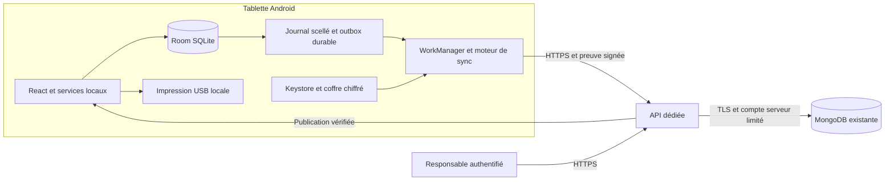
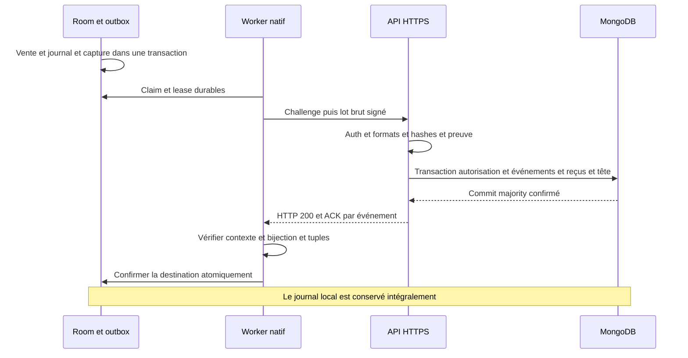
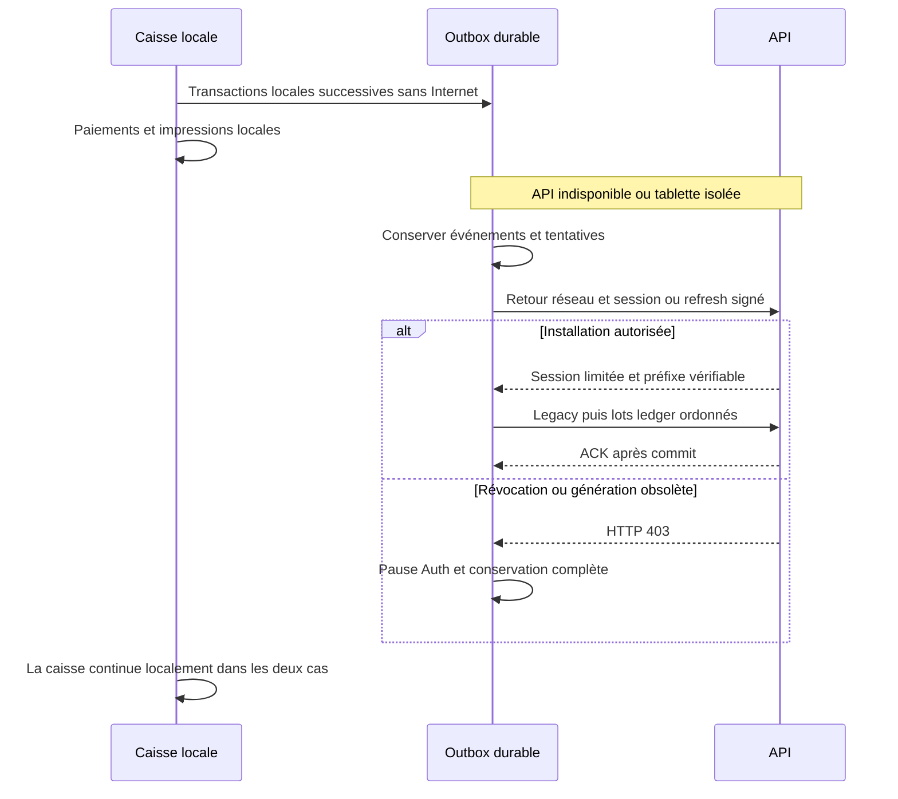
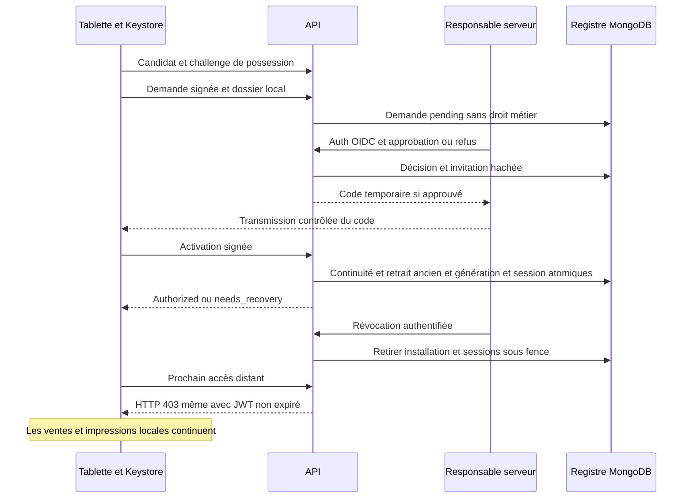
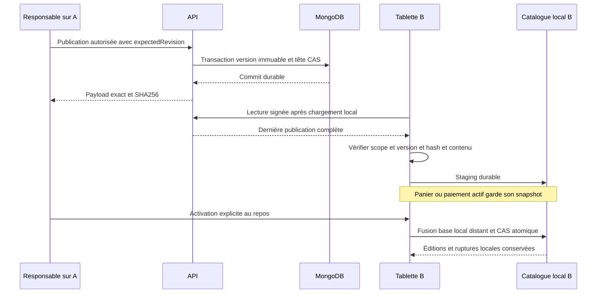

# Architecture MongoDB et migration offline-first (#129)

Version de décision : **1.0 — 23 octobre 2026**. Contrats conservés : **samhain-sync/1**, **samhain-auth/1**, publication **catalog-v1 / schemaVersion 1**.

Statut : architecture cible retenue pour [#129](https://github.com/Sylapho/samhain-pos/issues/129), à réaliser par #130–#138. Audit du checkout `9d3c5b8` ; l'issue et ses commentaires ont été lus (aucun commentaire). **Ce document ne livre ni API, ni migration de données, ni changement de transport.** Cette phrase décrit l’audit initial ; l’état actuel du code est précisé ci-dessous. Les identifiants, hébergements et données réelles ne sont pas connus.

## 1. Décisions et limites

État d’implémentation après #133 : la fondation serveur #130, la persistance #131,
l’enrôlement API/OIDC #132 et les trois routes financières #133 existent dans `server/`.
L’ingestion valide les cinq kinds, legacy et préfixe dans la transaction d’authentification,
avec reçus stables et vérification indépendante des deux profils historiques. Voir
le [contrat d’ingestion et ses tests](mongodb-ingestion.md).
Le client natif d’authentification utilise un coffre par destination et la reprise bornée
des rotations. Le transport financier Android attend #134 et le catalogue #135 ; leurs
chemins historiques restent actifs. Voir le [runbook d’enrôlement](tablet-enrollment.md).
Les sections prospectives ci-dessous décrivent les contrats, pas un déploiement réalisé.

1. **Tablettes Android → API HTTPS dédiée → MongoDB existante.** Room/SQLite reste l'autorité pour les opérations financières acquises sur chaque caisse. MongoDB conserve leur copie vérifiée et distribue des publications de catalogue ; aucun appel serveur n'entre dans une vente, un paiement/remboursement, une ouverture de session, une modification de fond, une clôture ou une impression.
2. Conserver le journal immuable, les cinq kinds, les hashes, les séquences, les snapshots, la capture transactionnelle dans l'outbox, les claims et WorkManager. Adapter les frontières configuration/Auth/transport, sans nouveau moteur de caisse ou seconde file financière.
3. Réutiliser les corps et ACK de `samhain-sync/1` sur des routes `/api/v1`. Conserver les deux profils financiers et leur canonicalisation de transport distincte. L'implémentation MongoDB remplace les garanties RPC/contraintes SQL, pas les données scellées.
4. Backend **Node.js 24 LTS, TypeScript strict, Fastify, driver MongoDB officiel**, application isolée future `server/` et manifeste/lockfile maîtrisés par pnpm. Versions correctives et compatibilité driver/serveur à figer dans #130, sans ajout de dépendance ici. Réutiliser les validateurs purs existants ; porter et tester les contrôles métier SQL, qui ne sont pas tous dans les Edge Functions.
5. Hébergement retenu : **service conteneurisé permanent derrière un reverse proxy HTTPS, dans le réseau ou la région de la base existante**. Une VM administrée suffit initialement ; un service de conteneurs géré est équivalent s'il fournit réseau privé ou sortie IP fixe, secrets, arrêt propre et supervision. Le fournisseur et la localisation attendent l'inventaire de la base ; aucune création Atlas ni ouverture publique de MongoDB n'est supposée.
6. Transactions multi-documents obligatoires. Une base standalone est **incompatible avec l'activation de l'ingestion**. Préférer un replica set non shardé ; accepter un cluster shardé seulement après preuve des transactions et des unicités nécessaires (§7).
7. Réenrôlement explicite sur l'API ; aucune conversion de token Supabase. Préserver la clé Keystore et l'identité d'installation quand leur possession est vérifiable, le `chainId` et les périmètres déjà liés. Nouvelle génération approuvée pour un remplacement ; aucune identité régénérée silencieusement.
8. **Un seul transport financier actif par chaîne.** Les reçus Supabase ne prouvent rien dans MongoDB. Le rattrapage porte aussi sur les événements déjà marqués `synced`, avec des confirmations techniques par destination (§10). Aucun reset Room, effacement d'outbox, revente, réimpression ou rescèlement.
9. Catalogue : même enveloppe `{payload, sha256}`, staging puis activation locale au repos, fusion base/local/distant, conflits explicites et ruptures locales conservées. Aucune proposition locale automatiquement publiée.

Le navigateur garde IndexedDB et ses tests de persistance ; il n'a actuellement ni enrôlement sécurisé ni worker réseau natif. Cette migration ne lui invente pas de session Android. La documentation Supabase reste une référence du transport actuel et de ses preuves historiques, pas une description du backend cible déjà déployé.

### Alternatives écartées

| Alternative                                                                      | Motif                                                                                                                                        |
| -------------------------------------------------------------------------------- | -------------------------------------------------------------------------------------------------------------------------------------------- |
| Connexion MongoDB dans le client, synchronisation indispensable à la vente       | Expose les credentials et rend la caisse dépendante du réseau.                                                                               |
| Réécriture Room/outbox ou nouveau journal pour MongoDB                           | Risque de perte, de duplication et d'invalidation de l'historique ; aucune nécessité métier.                                                 |
| NestJS, ORM/ODM imposé, broker ou microservices dès le départ                    | Pas de besoin établi ; Fastify et le driver exposent directement validation, sessions et transactions.                                       |
| Nouveau backend Deno Edge lié à une plateforme                                   | Le dépôt utilise déjà Node/pnpm ; un service permanent facilite les pools MongoDB et l'hébergement près de la base sans dépendance Supabase. |
| Insertions indépendantes puis ACK, `w:1`, LWW financier                          | Ne garantissent pas événement + reçu + tête durables.                                                                                        |
| Un journal complet dans un document MongoDB                                      | Croissance non bornée et contention ; les lots bornés et collections append-only correspondent au journal existant.                          |
| Double écriture simultanée Supabase/MongoDB ou suppression immédiate de Supabase | Pas de transaction commune entre destinations ; rollback et ACK ambigus.                                                                     |
| Copier automatiquement les données ou comptes Supabase                           | Inventaire et autorisation spécifiques absents ; les tablettes sont le point de départ prévu.                                                |

Aucun répertoire ADR ni convention ADR distincte n'existe dans `docs/` au moment de l'audit. Ce document porte la décision, ses alternatives et sa traçabilité ; pas d'ADR parallèle redondante.

## 2. Audit du code réel

Les chemins ci-dessous sont relatifs à la racine. `native/android/` est la source canonique ; les copies `android/app/src/main/java/fr/samhain/pos/` sont produites par `scripts/install-android-usb-printer.mjs`. Leur génération appartient aux futures issues natives, pas à #129.

### 2.1 Conserver

| Chemin réel                                                                                                                                                                                                                                                                    | Responsabilité et garantie                                                                                                                                                                   |
| ------------------------------------------------------------------------------------------------------------------------------------------------------------------------------------------------------------------------------------------------------------------------------ | -------------------------------------------------------------------------------------------------------------------------------------------------------------------------------------------- |
| [src/types/salesLedger.ts](../src/types/salesLedger.ts), [src/services/salesLedgerService.ts](../src/services/salesLedgerService.ts)                                                                                                                                           | Union des cinq kinds, snapshots, corrections historiques, sessions/fonds, clôtures et archives v1.                                                                                           |
| [native/android/RoomOrderStore.kt](../native/android/RoomOrderStore.kt), [native/android/SamhainPosDatabase.kt](../native/android/SamhainPosDatabase.kt)                                                                                                                       | Transactions locales, séquences, scellement, identité de chaîne, dossier d'enrôlement, garde-fous de restauration. Schéma Room **v9**, et non v7 décrit dans des livraisons antérieures.     |
| [src/services/indexedDbSchema.ts](../src/services/indexedDbSchema.ts), [src/services/orderRepository.ts](../src/services/orderRepository.ts), [src/services/outboxRepository.ts](../src/services/outboxRepository.ts)                                                          | Persistance Web et capture/backfill locaux ; pas de worker Android exécuté en navigateur fermé.                                                                                              |
| [native/android/OutboxEntry.kt](../native/android/OutboxEntry.kt), [native/android/OutboxStore.kt](../native/android/OutboxStore.kt)                                                                                                                                           | Capture des cinq kinds dans la transaction financière, backfill legacy puis ledger par 100, périmètre/fingerprint liés, claims de 120 s, acquittement atomique ; le journal n'est pas purgé. |
| [native/android/SyncProtocol.kt](../native/android/SyncProtocol.kt), [native/android/CanonicalJson.kt](../native/android/CanonicalJson.kt), [src/utils/ledgerCanonicalization.ts](../src/utils/ledgerCanonicalization.ts), [src/utils/integrity.ts](../src/utils/integrity.ts) | Deux profils financiers, fingerprint transport et validation stricte de la bijection d'ACK.                                                                                                  |
| [native/android/TabletCredentialVault.kt](../native/android/TabletCredentialVault.kt)                                                                                                                                                                                          | RSA 2048 non exportable Keystore, AES-GCM, fichier atomique dans `noBackupFilesDir`, aucune régénération silencieuse de clé perdue.                                                          |
| [src/services/catalogDistribution.ts](../src/services/catalogDistribution.ts), [src/services/catalogDistributionService.ts](../src/services/catalogDistributionService.ts), [src/types/catalogDistribution.ts](../src/types/catalogDistribution.ts)                            | Validation des publications, base/active/pending, fusion à trois sources, décisions, CAS et activation sûre.                                                                                 |
| [src/services/catalogRepository.ts](../src/services/catalogRepository.ts), [native/android/RoomCatalogStore.kt](../native/android/RoomCatalogStore.kt)                                                                                                                         | Snapshot produits/catégories et métadonnées atomiques ; vérification des intentions durables lors d'une activation.                                                                          |
| [src/printing/orderPrintService.ts](../src/printing/orderPrintService.ts), [src/printing/](../src/printing/), [native/android/EpsonUsbPrinterPlugin.kt](../native/android/EpsonUsbPrinterPlugin.kt)                                                                            | Rendu/orchestration/transport USB séparés de la synchronisation ; aucun appel/retry d'impression depuis le rattrapage.                                                                       |

### 2.2 Adapter dans les issues suivantes

| Chemin réel                                                                                                                                                                                                                                                                                                | Adaptation nécessaire                                                                                                                                                                                      |
| ---------------------------------------------------------------------------------------------------------------------------------------------------------------------------------------------------------------------------------------------------------------------------------------------------------- | ---------------------------------------------------------------------------------------------------------------------------------------------------------------------------------------------------------- |
| [native/android/SyncEngine.kt](../native/android/SyncEngine.kt)                                                                                                                                                                                                                                            | Réutiliser injection `send`, ordre, backoff avec jitter 5 s à 6 h, récupération complète par tuples ; ajouter contexte de destination aux confirmations.                                                   |
| [native/android/OutboxWorker.kt](../native/android/OutboxWorker.kt), [native/android/OutboxStartupProvider.kt](../native/android/OutboxStartupProvider.kt)                                                                                                                                                 | WorkManager unique par chaîne, réseau connecté, rescan 15 min et capture locale au démarrage ; remplacer la condition `SupabaseConfiguration` et le fournisseur Auth, conserver la reprise des leases.     |
| [native/android/OutboxStore.kt](../native/android/OutboxStore.kt)                                                                                                                                                                                                                                          | `acknowledge()` exige le même reçu/date s'ils sont déjà présents. Un reçu MongoDB neuf ne peut donc pas remplacer directement le reçu Supabase ; suivi par destination et reprise explicite requis (§10).  |
| [native/android/TabletAuthService.kt](../native/android/TabletAuthService.kt), [native/android/TabletAuthPlugin.kt](../native/android/TabletAuthPlugin.kt), [src/native/tabletAuth.ts](../src/native/tabletAuth.ts), [src/services/tabletEnrollmentService.ts](../src/services/tabletEnrollmentService.ts) | Conserver verrou de session, preuve du corps brut, coffre et absence de getter token JS ; remplacer signup/refresh/password/logout Supabase et les routes Edge.                                            |
| [native/android/CatalogStoragePlugin.kt](../native/android/CatalogStoragePlugin.kt), [src/native/catalogStorage.ts](../src/native/catalogStorage.ts), [src/features/catalog/CatalogSynchronization.tsx](../src/features/catalog/CatalogSynchronization.tsx)                                                | Rebrancher lecture/publication sécurisées ; conserver le service de fusion et les barrières panier/options/paiement.                                                                                       |
| [src/features/terminal/TabletSynchronizationSettings.tsx](../src/features/terminal/TabletSynchronizationSettings.tsx)                                                                                                                                                                                      | Réenrôlement API, authentification responsable serveur et statut, sans faire du PIN une habilitation distante.                                                                                             |
| [src/features/responsible/SynchronizationStatus.tsx](../src/features/responsible/SynchronizationStatus.tsx), [src/services/synchronizationService.ts](../src/services/synchronizationService.ts), [src/services/synchronizationStatus.ts](../src/services/synchronizationStatus.ts)                        | Diagnostics lus localement, dates de réception et confirmation distinctes ; ne montrer la nouvelle destination reçue qu'après ses propres ACK. Rafraîchir le suivi n'est actuellement pas un ping serveur. |

### 2.3 Spécifique à Supabase, à remplacer

| Chemin réel                                                                                                                                                                                                                                                                                                                           | Responsabilité actuelle / remplacement                                                                                                                                                                              |
| ------------------------------------------------------------------------------------------------------------------------------------------------------------------------------------------------------------------------------------------------------------------------------------------------------------------------------------- | ------------------------------------------------------------------------------------------------------------------------------------------------------------------------------------------------------------------- |
| [src/config/supabase.ts](../src/config/supabase.ts), [src/config/supabaseRuntime.ts](../src/config/supabaseRuntime.ts), [src/vite-env.d.ts](../src/vite-env.d.ts)                                                                                                                                                                     | Configuration publique validée, globale `__SUPABASE_CONFIGURATION__`, séparation test/production ; future configuration publique API.                                                                               |
| [scripts/supabase-build.ts](../scripts/supabase-build.ts), [vite.config.ts](../vite.config.ts), [.env.example](../.env.example)                                                                                                                                                                                                       | `envPrefix: []`, liste explicite des données injectées, garde secrets, `public/samhain-build.json` généré ; conserver ces protections et étendre le scan aux credentials MongoDB.                                   |
| [native/android/SupabaseConfiguration.kt](../native/android/SupabaseConfiguration.kt), [native/android/supabase-config.gradle](../native/android/supabase-config.gradle), [android/app/supabase-config.gradle](../android/app/supabase-config.gradle)                                                                                 | Asset public HTTPS, clé publishable, environnement confirmé et garde release ; remplacer URL/projet/clé Supabase par origin API et destination contrôlés.                                                           |
| [native/android/TabletAuthService.kt](../native/android/TabletAuthService.kt)                                                                                                                                                                                                                                                         | `SupabaseAuthHttp` ajoute `apikey`, utilise `/auth/v1` et `/functions/v1`, refuse redirections, borne réponses à 1 MiB, impose échéance 30 s. Garder ces dernières garanties ; supprimer le besoin de clé Supabase. |
| [supabase/functions/tablet-auth-v1/index.ts](../supabase/functions/tablet-auth-v1/index.ts), [supabase/functions/_shared/tabletAuth.ts](../supabase/functions/_shared/tabletAuth.ts)                                                                                                                                                  | Auth `/user`, principal/session vérifiés, RSA et appels RPC ; substituer registre/sessions API, conserver la preuve cryptographique.                                                                                |
| [supabase/functions/ledger-ingest-v1/index.ts](../supabase/functions/ledger-ingest-v1/index.ts), [supabase/functions/legacy-import-v1/index.ts](../supabase/functions/legacy-import-v1/index.ts), [supabase/functions/ledger-prefix-v1/index.ts](../supabase/functions/ledger-prefix-v1/index.ts)                                     | Entrées HTTPS et délégation à une transaction RPC ; futures routes MongoDB.                                                                                                                                         |
| [supabase/functions/_shared/syncProtocol.ts](../supabase/functions/_shared/syncProtocol.ts), [supabase/functions/_shared/syncHttp.ts](../supabase/functions/_shared/syncHttp.ts)                                                                                                                                                      | Réutiliser validation stricte, profils, fingerprint, formats et erreurs ; remplacer Auth/REST RPC et dépendances d'exécution Deno.                                                                                  |
| [supabase/functions/catalog-v1/index.ts](../supabase/functions/catalog-v1/index.ts), [supabase/functions/_shared/catalogHttp.ts](../supabase/functions/_shared/catalogHttp.ts)                                                                                                                                                        | Validation catalogue déjà partagée avec le client, lecture sous preuve, publication responsable puis RPC ; future transaction MongoDB.                                                                              |
| [supabase/migrations/20261014180000_pos_schema.sql](../supabase/migrations/20261014180000_pos_schema.sql), [20261014180100_pos_guards_and_rls.sql](../supabase/migrations/20261014180100_pos_guards_and_rls.sql)                                                                                                                      | Tables, FK, unicités, append-only, projections et RLS ; MongoDB ne fournit pas leur transposition automatique.                                                                                                      |
| [supabase/migrations/20261014200000_tablet_enrollment.sql](../supabase/migrations/20261014200000_tablet_enrollment.sql), [20261014210000_ledger_ingestion.sql](../supabase/migrations/20261014210000_ledger_ingestion.sql), [20261021100000_catalog_distribution.sql](../supabase/migrations/20261021100000_catalog_distribution.sql) | Invitations, générations, anti-rejeu, sérialisation révocation/ingestion, règles métier des cinq kinds, reçus durables, catalogue CAS. À porter intégralement sous tests, pas uniquement les handlers TS.           |

### 2.4 Supprimer seulement après validation du basculement (#138)

| Ensemble réel                                                                                                                                                                                                                                                                                                                                                                                                                                                                                                                                                                                                 | Condition de retrait                                                                                                                                                                                                     |
| ------------------------------------------------------------------------------------------------------------------------------------------------------------------------------------------------------------------------------------------------------------------------------------------------------------------------------------------------------------------------------------------------------------------------------------------------------------------------------------------------------------------------------------------------------------------------------------------------------------- | ------------------------------------------------------------------------------------------------------------------------------------------------------------------------------------------------------------------------ |
| [supabase/config.toml](../supabase/config.toml), `supabase/functions/`, `supabase/migrations/`, `supabase/tests/`                                                                                                                                                                                                                                                                                                                                                                                                                                                                                             | Dernier APK dépendant retiré, preuves archivées, équivalents MongoDB validés ; aucune suppression de données distantes impliquée.                                                                                        |
| `src/config/supabase*`, `scripts/supabase-build.ts`, templates et copies Gradle/config Kotlin Supabase                                                                                                                                                                                                                                                                                                                                                                                                                                                                                                        | Références actives Vite/natif/installation remplacées ; tests anti-secret conservés sous leur nouvelle forme.                                                                                                            |
| [scripts/test-supabase-integration.mjs](../scripts/test-supabase-integration.mjs), [test-supabase-room.mjs](../scripts/test-supabase-room.mjs), [test-supabase-ingest.mjs](../scripts/test-supabase-ingest.mjs), [test-supabase-migrations.mjs](../scripts/test-supabase-migrations.mjs), [test-supabase-enrollment-concurrency.mjs](../scripts/test-supabase-enrollment-concurrency.mjs), [scripts/lib/supabase-local.mjs](../scripts/lib/supabase-local.mjs), [.github/workflows/supabase.yml](../.github/workflows/supabase.yml)                                                                           | Portage de la matrice vers vrai replica set de test et CI avant retrait. `package.json` expose `test:supabase` et `test:supabase:room` ; **aucun SDK Supabase ni driver MongoDB n'est actuellement une dépendance npm**. |
| [docs/architecture-supabase-offline-first.md](architecture-supabase-offline-first.md), [supabase-configuration.md](supabase-configuration.md), [supabase-database.md](supabase-database.md), [supabase-ingestion.md](supabase-ingestion.md), [tablet-enrollment.md](tablet-enrollment.md), [catalog-distribution.md](catalog-distribution.md), [outbox-synchronization.md](outbox-synchronization.md), [supabase-integration-validation.md](supabase-integration-validation.md), [supabase-deployment-runbook.md](supabase-deployment-runbook.md), [issue-114-implementation.md](issue-114-implementation.md) | Marquer le statut historique ou adapter les procédures après bascule ; ne pas effacer les invariants encore valables. README et docs Android à actualiser avec les commandes réellement livrées.                         |

Tests à conserver/adapter : `src/utils/ledgerCanonicalization.test.ts`, `src/services/{salesLedgerService,outboxRepository,catalogDistribution,synchronizationService,synchronizationStatus,tabletEnrollmentService}.test.ts`, tests UI catalogue/terminal/suivi, `native/android/tests/{CanonicalJsonConformanceTest,SyncProtocolTest,OutboxStoreTest,OutboxWorkManagerTest,TabletAuthServiceTest,SupabaseSyncHttpTest,SupabaseConfigurationTest,LiveSupabaseIntegrationTest,RoomCatalogStoreTest}.kt`, tests `_shared/*.test.ts` et SQL. Le service de distribution est couvert dans `catalogDistribution.test.ts` ; il n'existe pas de fichier de test séparé `catalogDistributionService.test.ts`. Les noms Supabase pourront changer, les scénarios doivent rester. Les résultats des anciennes documentations ne sont pas des tests exécutés pour #129.

Écarts documentation/code relevés : l'architecture #111 parle de workers futurs alors qu'ils existent ; Room est v9 ; le message de configuration TS « service non encore activé » ne décrit pas le worker livré ; le Web ne possède pas le transport sécurisé Android. Aucun de ces textes ne prouve un déploiement réel.

## 3. Composants et frontières de confiance



La WebView et le réseau sont non fiables : aucune assertion `organizationId`, rôle, `terminalId`, hash ou `committed` n'est une autorité par elle-même. Le natif garde les credentials hors JS, mais le serveur vérifie systématiquement identité, session, preuve, périmètre et données. Le PIN responsable est une barrière UI locale.

Le serveur est la frontière d'autorisation : aucun endpoint MongoDB/PostgREST générique, aucune requête Mongo arbitraire fournie par un client, aucun filtre `$` construit depuis un objet utilisateur non validé. Les requêtes sont construites champ par champ, toujours avec périmètre issu d'une autorisation vérifiée. Le reverse proxy ne doit pas réécrire le corps signé ; les headers forwarded ne sont acceptés que de ce proxy connu.

MongoDB n'a pas la RLS/FK PostgreSQL du dépôt : l'API impose les relations et droits sous transaction ; les index/validateurs/rôles DB ajoutent des protections indépendantes. L'administration DB reste privilégiée et distincte : l'immutabilité applicative ne protège pas contre un administrateur malveillant. Sauvegardes indépendantes, audits et comparaison aux journaux locaux restent nécessaires.

## 4. Identités et multi-tablettes

| Identifiant            | Usage constaté et règle cible                                                                                                                                                                                                                                                  |
| ---------------------- | ------------------------------------------------------------------------------------------------------------------------------------------------------------------------------------------------------------------------------------------------------------------------------ |
| `organizationId`       | UUID d'autorité distante ; aucune dérivation du nom/SIRET du snapshot. Périmètre immuable d'une chaîne liée.                                                                                                                                                                   |
| `festivalId`           | UUID de festival sous organisation ; chaque droit porte les deux identifiants, contrôlés côté serveur.                                                                                                                                                                         |
| `terminalId`           | Identité métier locale opaque, historiquement A/B/C/D et snapshots antérieurs possibles. Pas une clé d'installation ni un UUID obligatoire. Autoriser les plages historiques de séquences ; un terminal peut réapparaître dans plusieurs plages.                               |
| `installationId`       | UUID physique/logique dans le coffre natif, associé à une clé publique vérifiée. Stable pendant une mise à jour APK ; restaurer une archive financière ne restaure pas ce credential.                                                                                          |
| `chainId`              | UUID durable indépendant du terminal, dans `sync_identity` Room. Une base locale produit un journal global pour ses cinq kinds. Le dossier présente son préfixe ; `bindSyncChain` interdit de changer une identité déjà liée et de relier des fingerprints à une autre chaîne. |
| `enrollmentGeneration` | Entier sûr positif, attribué et vérifié par le serveur. L'activation d'un remplacement retire l'installation précédente et augmente la génération atomiquement. N'entre pas dans le hash/fingerprint financier.                                                                |

Une seule installation active par chaîne et destination. Chaque chaîne est assignée à un unique couple organisation/festival ; `chainId` et `installationId` restent globalement uniques dans le registre pour éviter une réaffectation ambiguë. Les événements/indices incluent quand même les périmètres. Aucun changement de périmètre d'une outbox déjà liée : il changerait ses fingerprints ; conserver l'incident pour résolution.

**Deux tablettes indépendantes** : A et B ont installations, clés et chaînes distinctes, autorisées dans le même festival. Hors ligne, chacune écrit ses ventes/sessions/corrections avec ses propres séquences et numéros. À la reconnexion, la tête A et la tête B avancent indépendamment ; ni horloge globale ni renumérotation. Deux reçus imprimés de même libellé ne sont pas une collision financière. Une réutilisation du même `order.id` dans l'autre chaîne du même périmètre renvoie `DUPLICATE_ORDER_OTHER_CHAIN`, elle n'est ni comptée deux fois ni supprimée localement.

**Deux copies de la même chaîne** : une seule génération/installation peut uploader. Si une mauvaise autorisation laisse deux branches proposer la même séquence, l'unicité/CAS permet au premier commit durable de gagner et refuse l'autre avec `SEQUENCE_FORK`. Conserver les deux preuves, exporter, diagnostiquer le premier écart. Pas de fusion, re-hash, renumérotation ou changement de `chainId` pour faire accepter le suffixe orphelin. Une révocation distante n'empêche pas physiquement une copie isolée d'encaisser ; elle empêche ses prochains accès distants.

## 5. Contrats financiers inchangés

### 5.1 Formes et dépendances

| Kind et ID produit actuellement                         | Données et validations à reproduire dans l'API                                                                                                                                                                                                                                                               |
| ------------------------------------------------------- | ------------------------------------------------------------------------------------------------------------------------------------------------------------------------------------------------------------------------------------------------------------------------------------------------------------ |
| `sale`, `sale:<order.id>`                               | `orderId` et `ImmutableOrderSnapshot` complet, sans `printing`/`integrity` imbriqués. Lignes/options, quantités, montants entiers en cents, paiement et totaux validés depuis le snapshot, jamais depuis le catalogue courant.                                                                               |
| `correction`, `correction:<operationId>`                | Conserver cancellation/refund/adjustment, motif, delta, paiement, références et `originalSaleHash`. Vérifier vente antérieure de la même chaîne ou legacy importée, cumuls/quantités remboursés et `refundLines` lorsqu'elles existent. Ne pas inventer ces lignes sur une correction historique sans elles. |
| `closure`, `closure:<operationId>`                      | Période, totaux par paiement et cumuls depuis le préfixe validé ; mêmes bornes temporelles que le code local. `cashSessionId`, `openingFloatCents`, `theoreticalCashCents` peuvent être absents historiquement. Aucun calcul rétroactif ajouté au payload.                                                   |
| `cash_session_opened`, `cash-session:<sessionId>`       | Session, début, date, fond initial ; unicité session et session active compatibles avec les contrôles locaux.                                                                                                                                                                                                |
| `cash_float_updated`, `cash-float-update:<operationId>` | Référence de session, ancien/nouveau fond et date ; session active et ancienne valeur attendue, pas de remplacement d'un événement précédent.                                                                                                                                                                |

Ces préfixes décrivent les producteurs, **pas une grammaire de validation d'ID**. `eventId`, `orderId`, `operationId`, `sessionId` et `sourceTerminalId` sont opaques, non vides, bornés ; les UUID sont requis pour le contexte distant et `requestId`, pas pour un ID `sale:...`.

Importer les commandes legacy non scellées avant les corrections qui y font référence. Elles utilisent `eventType: legacy_order`, `payloadCanonical` du snapshot sans états d'impression/intégrité, avec `ledgerSchemaVersion`, `sequence`, `hash`, `previousHash`, `ledgerCanonicalization` **null** ; pas de faux événement financier ni d'avancement de tête. Un snapshot historique sans terminal garde son absence : le dossier approuvé fournit `sourceTerminalId` d'enveloppe. `originalSaleHash: null` reste null pour une correction legacy. Les ventes legacy ne sont pas ajoutées aux totaux ledger qui les excluent aujourd'hui ; les restitutions doivent distinguer couverture et complétude.

### 5.2 Octets, hashes et compatibilité TS/Kotlin/backend

Le backend reprend les règles de `syncProtocol.ts`, `SyncProtocol.kt`, `ledgerCanonicalization.ts`, `CanonicalJson.kt` et leurs vecteurs, sans importer les dépendances Supabase de transport.

- `ts-ledger-v1` : `canonicalJson` récursif, clés triées par unités UTF-16, tableaux inchangés, chaînes selon `JSON.stringify`, pas d'espace ni normalisation Unicode.
- `android-ledger-v1` : mêmes règles financières, **tous les `/` sont échappés `\/`**, comme `JSONObject.quote` Android. Un journal peut contenir les deux profils ; le profil est déterminé en reproduisant le hash existant, pas par `buildMode`.
- Hash financier : SHA-256 UTF-8 de l'objet complet **sans son champ `hash`**, selon le profil reconnu, hex minuscule de 64 caractères. `previousHash` est null seulement à la séquence 1. Le texte complet avec hash est stocké exactement dans `payloadCanonical` ; sa projection BSON ne sert jamais de preuve de ses octets.
- `transport-json-v1` : canonicalisation TS, slash non échappé, ordre UTF-16, champs absents distincts des null explicites ; entiers sûrs décimaux, `-0` devient `0`, pas de BOM/newline final. Les règles financières de schéma 1 n'autorisent pas de flottants monétaires.
- `transportFingerprint` = SHA-256 de la représentation transport de l'objet exact suivant : `{protocolVersion, organizationId, festivalId, chainId, eventId, eventType, ledgerSchemaVersion, sourceTerminalId, sequence, hash, previousHash, ledgerCanonicalization, payloadCanonical}`. Installation, génération, destination, date de tentative, token et `requestId` sont exclus. Il reste donc identique lors du réenrôlement/rattrapage vers le même périmètre.
- Parseur strict avant `JSON.parse` : UTF-8 valide, profondeur ≤64, pas de clés dupliquées ni surrogates isolés, nombres entiers exacts dans ±9 007 199 254 740 991. Les clés hors contrat sont refusées, jamais supprimées. Conserver initialement le refus U+0000 du serveur SQL pour ne pas étendre silencieusement le profil v1 ; une extension éventuelle nécessite ses vecteurs et une décision séparée.

La signature d'installation couvre le **corps HTTP brut**, pas sa canonicalisation : RSA PKCS#1 v1.5 / SHA-256, clé ≥2048, clé publique SPKI et signature Base64, message UTF-8 `samhain-auth/1\n<installationId>\n<action>\n<nonce>\n<SHA256(corps brut)>`. Conserver les noms d'action `ledger-ingest-v1`, `legacy-import-v1`, `ledger-prefix-v1`, `catalog-v1` indépendamment de leurs nouvelles routes ; une route ne peut pas être utilisée avec la preuve d'une autre action.

Les octets sont préservés avant validation Fastify : désactiver coercition, ajout de défauts et suppression de propriétés pour ces corps. Pas de normalisation de date, conversion BSON Date/ObjectId, tri de tableaux, modification d'échappements ou remplissage de champs historiques dans le payload. Les dates serveur et projections typées restent dans des champs séparés. Le backend **recalcule pour vérifier** le profil existant ; il ne remplace jamais la représentation ou le hash soumis par une version « corrigée ».

### 5.3 ACK et reprise



L'ACK conserve le contexte et les champs actuels (§8). Le client exige HTTP **200** ; `201` ou autre 2xx n'est pas un acquittement de lot. `SyncProtocol.validateAck` vérifie `protocolVersion`, `requestId`, organisation/festival/chaîne, `committed: true`, bijection exacte des événements, absence de doublons, sequence/hash/fingerprint identiques, receiptId UUID, date UTC terminée par Z, statut `accepted|already_present` et cohérence de tête. L'installation et la génération sont vérifiées avant envoi par le service natif et côté serveur ; elles ne sont actuellement pas des champs d'écho ACK. Ne pas prétendre qu'elles le sont.

Un ACK valide met seulement la confirmation technique de cette destination à jour dans la transaction locale. Il ne supprime ni événement, ni commande, ni archive. Le JSON d'un ACK n'est pas à lui seul une preuve indépendante de durabilité : la garantie dépend du serveur authentifié et de ses tests transactionnels.

| Situation                                                       | Décision serveur/client                                                                                                                                                |
| --------------------------------------------------------------- | ---------------------------------------------------------------------------------------------------------------------------------------------------------------------- |
| Événement inédit                                                | Autorisé, séquence tête+1 et `previousHash` exact, dépendances/règles valides : commit lot et reçus puis ACK.                                                          |
| Même événement exact                                            | Comparer ID, séquence, profil, payload canonique complet, hash, fingerprint ; `already_present`, **même receiptId/date de première réception** pour cette destination. |
| Même ID, contenu différent                                      | `EVENT_CONTENT_CONFLICT` ; aucun remplacement. Hash mensonger détecté d'abord par `INVALID_HASH`.                                                                      |
| Séquence occupée par un autre ID / lien divergent               | `SEQUENCE_FORK`, quarantaine réseau ; conserver les preuves.                                                                                                           |
| Première nouvelle séquence au-delà de tête+1 / trou dans le lot | `MISSING_PREDECESSOR`, diagnostic/backfill borné ; ne pas sauter.                                                                                                      |
| Tête attendue obsolète avec successeur valide                   | `HEAD_MOVED` ; vérifier tous les tuples, pas seulement la tête.                                                                                                        |
| Référence métier absente                                        | `DEPENDENCY_MISSING`, importer legacy/préfixe requis ; aucune invention de vente/session.                                                                              |
| ACK perdu ou coupure après commit                               | Nouvelle tentative avec nouveau nonce ; replay identique renvoie les reçus durables, aucune nouvelle vente.                                                            |
| Échec au milieu du lot                                          | **Aucune nouvelle écriture du lot committée** ; les replays déjà durables restent présents. Pas d'ACK partiel.                                                         |
| Prefix `match`                                                  | Information de diagnostic seulement ; ne marque pas un événement `synced` sans ACK d'ingestion.                                                                        |
| Serveur plus avancé qu'une archive                              | Aucun recul de tête, état `needs_recovery` ; pas de fusion automatique d'un suffixe dans une caisse active.                                                            |

Priorité déterministe après Auth/format/empreintes : conflits d'identité ou de séquence occupée, puis lacune, puis tête obsolète, puis dépendances et règles métier. Les replays d'un lot sont un préfixe contigu avant les nouveaux événements ; pas de replay après un nouvel événement. Un lot entièrement replayé peut fournir son ancienne `expectedHead`. Un lot mixte doit fournir la tête durable **avant son premier nouvel événement** ; une ancienne tête ne suffit pas. Le worker actuel peut obtenir `HEAD_MOVED` dans ce cas, puis comparer/rejouer des lots entièrement présents et enfin le suffixe.

## 6. Hors ligne et sécurité des accès



Les erreurs réseau sont transitoires avec backoff/jitter et `Retry-After` ; expiration/401 déclenche au plus le renouvellement maîtrisé, 403 suspend les échanges. La révocation ne dépend pas de l'expiration d'un JWT : chaque opération vérifie le registre vivant. Aucun retry de synchronisation ne valide un paiement ni ne lance une impression. Après force-stop, Android peut différer WorkManager jusqu'à relance autorisée ; ne pas promettre un délai de synchronisation garanti. Le scan de démarrage couvre la fenêtre commit→enqueue ; les leases expirées sont récupérées.

### 6.1 Modèle d'authentification cible

- Tablettes : sessions API propres, JWT courts signés par le serveur (cible initiale 10 min), `iss/aud/exp/iat/sub/jti` validés avec algorithme imposé, contexte installation/génération/périmètre vérifié dans le registre. Un `sessionId` vivant permet de fermer une session avant expiration. Refresh aléatoire ≥256 bits, stocké haché côté serveur, lié à la clé/génération, rotation et invalidation de famille sur rejeu hors retry exact contrôlé.
- Le coffre conserve les credentials API chiffrés dans un espace de destination distinct du coffre Supabase ; persister une rotation avant de l'utiliser. Le verrou de session natif est conservé. Un crash après rotation mais avant réponse nécessite la reprise de rotation ci-dessous, jamais un retry illimité du vieux refresh.
- Renouvellement : `rotationId` UUID persisté avant envoi ; même ancien refresh + même rotationId + même preuve de clé peut récupérer **la même** réponse pendant une fenêtre bornée de 60 s, chiffrée côté serveur pour cette reprise et jamais journalisée. Après cette fenêtre, reconnexion/enrôlement explicite. Même ancien refresh avec autre rotationId est un rejeu, session suspendue. Expiration d'inactivité cible 30 jours, durée absolue 90 jours ; paramètres de sécurité à approuver/figer dans #132, sans effet sur la caisse hors ligne.
- Responsables : fournisseur **OIDC** maintenu, flux Authorization Code + PKCE via navigateur système, compte nominatif/MFA selon politique. Token destiné à cette API, issuer/audience/signature contrôlés ; mapping `(issuer, sub)` vers les droits MongoDB. Aucun mot de passe partagé ni hash de mot de passe artisanal. Le fournisseur réel est un prérequis non résolu de #132 ; l'écran actuel email/password Supabase doit être adapté. Pas de migration de mots de passe ni de confiance dans un JWT Supabase présenté comme JWT API.
- Capacités distinctes `manage_enrollment`, `read_ledger`, `publish_catalog`. Un responsable qui publie ne lit pas automatiquement le ledger ; un gestionnaire d'enrôlement ne publie pas automatiquement. Les tablettes ne lisent que leur diagnostic de chaîne et le catalogue de leur périmètre ; aucune lecture globale de ventes n'est ajoutée.
- Challenge aléatoire à usage unique, TTL logique 60 s et limite initiale 60/min/installation et quotas IP ; expiration contrôlée au moment de l'opération, indépendamment du nettoyage TTL. Associer challenge au sujet/session ou au candidat pending, à la clé et à l'installation ; aucune donnée financière accessible avec une identité pending. Chaque retry réseau utilise un nouveau challenge. La preuve autorise une opération, le fingerprint garantit seulement son contenu.

### 6.2 Enrôlement, activation, refus et révocation



Conserver les garde-fous du dossier réel : préfixe `{sequence,eventId,hash,terminalId}`, inventaire `legacyOrderIds`, `chainId`, `restored`, terminal courant et clé publique ; vérification locale de la cohérence commande↔ledger avant émission. `RoomOrderStore.enrollmentDossier` refuse actuellement **10 000 entrées ou plus** et le transport borne le corps à 1 MiB. Ne pas annoncer une migration illimitée : prévoir dans #132 un protocole de dossier paginé et scellé séparé ou une procédure administrative contrôlée ; tant qu'il manque, gros dossier = `needs_recovery`, jamais troncature/échantillonnage du préfixe.

Demande valide 24 h, invitation ≥256 bits, hash seulement, 10 min, liée à la demande/clé/installation approuvées et cinq essais maximum comme le mécanisme actuel. Approbation ne vaut pas activation. L'activation consomme l'invitation, vérifie la continuité, retire le prédécesseur, incrémente sa génération si remplacement, et crée la session dans une transaction. L'état `needs_recovery` permet uniquement le diagnostic autorisé, pas l'upload ; une résolution administrative après preuves est nécessaire pour passer à `authorized`.

Enrôler la même installation vers une autre destination n'est pas restaurer une archive : ne pas appeler `prepareReplacement()` et ne pas effacer le coffre/Room existant. Si la clé est perdue, créer une nouvelle installation explicitement approuvée et retirer l'ancienne. Les archives financières v1 n'incluent pas `chainId` ni les credentials ; leur rapprochement s'appuie sur un dossier/mapping externe approuvé, jamais une modification sous l'ancien `archiveHash`.

## 7. Modèle MongoDB, cohérence et hébergement

### 7.1 Collections proposées

Noms cibles, **aucune collection créée ici**. Chaque document métier contient `documentSchemaVersion: 1` séparé des versions financières/wire. Le payload original reste une chaîne UTF-8 exacte ; une projection BSON strictement validée est facultative et reconstruisible. Pas de tableau de tous les événements dans une tête de chaîne.

| Collection                                                                  | Contenu et droits d'écriture                                                                                                                                                                                               |
| --------------------------------------------------------------------------- | -------------------------------------------------------------------------------------------------------------------------------------------------------------------------------------------------------------------------- |
| `organizations`, `festivals`, `scopeGrants`, `authorizationGuards`          | Périmètres actifs, sujets OIDC/API, capacités et fences de révocation. Administration limitée, aucune écriture depuis un corps tablette non autorisé.                                                                      |
| `enrollmentRequests`, `installations`, `installationKeys`, `terminalRanges` | Dossiers, décisions, clés publiques, installations actives/générations, preuves des plages historiques. La clé privée reste sur tablette.                                                                                  |
| `apiSessions`, `refreshRotations`, `authChallenges`, `administrationAudit`  | Sessions/refresh hachés, reprise chiffrée temporaire de rotation, anti-rejeu et audit expurgé. TTL seulement sur documents éphémères appropriés.                                                                           |
| `chains`                                                                    | Périmètre immuable, génération, tête `{sequence,hash}`, compteur de fence ; un seul document mutable de tête par chaîne.                                                                                                   |
| `ledgerEvents`                                                              | Enveloppe immuable, `payloadCanonical`, profil, fingerprint, kind/références et date de première réception séparée. Rôle applicatif : find/insert seulement.                                                               |
| `sales`                                                                     | Projection minimale d'unicité `orderId` par périmètre, référence de vente scellée ou snapshot legacy exact ; pas de second calcul de vente ni de prix courant. Find/insert seulement.                                      |
| `syncReceipts`                                                              | Reçu stable par événement et destination, receiptId/date, hash/sequence/fingerprint, première installation/génération/requestId ; find/insert seulement, pas de TTL.                                                       |
| `catalogVersions`, `catalogHeads`                                           | Publication immuable avec payload/hash et métadonnées auteur, tête mutable sous CAS. Produits/catégories/disponibilité centrale inclus dans chaque snapshot publié, pas besoin de collections produit mutables parallèles. |

Les propositions/ruptures locales restent dans Room/IndexedDB. Aucun registre central de propositions n'est implémenté aujourd'hui ; une future collection `catalogProposals` nécessiterait une issue et une décision explicites. `administrationAudit` ne contient ni code d'invitation, ni token, ni payload financier complet.

### 7.2 Index et contraintes

Notation `S = (organizationId, festivalId)` ; `C = (organizationId, festivalId, chainId)`. Collation simple binaire pour les identités ; aucun case-folding d'ID opaque. UUID de contexte normalisés seulement à l'entrée du registre, jamais à l'intérieur des payloads scellés.

| Collection                                          | Index uniques requis                                                                                                                                              |
| --------------------------------------------------- | ----------------------------------------------------------------------------------------------------------------------------------------------------------------- |
| `organizations`, `festivals`                        | `organizationId` ; `S` pour festivals.                                                                                                                            |
| `chains`                                            | `chainId` global et `C`.                                                                                                                                          |
| `installations` / `installationKeys`                | `installationId` global ; sujet tablette unique ; index partiel `C` avec `active: true` pour une installation active par chaîne ; clé par installation.           |
| `scopeGrants`                                       | `(issuer,subject,S,capability)` ; les sessions tablette utilisent un issuer API distinct.                                                                         |
| `ledgerEvents`                                      | `(C,eventId)`, `(C,sequence)` ; `(C,kind,operationId)` partiel lorsque operationId est une chaîne ; `(C,sessionId)` partiel pour `cash_session_opened` seulement. |
| `sales`                                             | `(S,orderId)` pour interdire le double comptage scellé/legacy et inter-chaînes.                                                                                   |
| `syncReceipts`                                      | `(C,eventType,eventId)` et `receiptId` global ; une destination utilise sa propre base/namespace et son registre de reçus.                                        |
| `terminalRanges`                                    | `(C,firstSequence)` ; absence de chevauchement et bornes contrôlées sous fence de chaîne, un index seul ne suffit pas.                                            |
| `catalogVersions` / `catalogHeads`                  | `(S,revision)` et ID de version unique ; `S` pour la tête.                                                                                                        |
| `enrollmentRequests`                                | `requestId`, `installationId` pour demande courante, `invitationHash` partiel si présent ; décisions historiques dans audit.                                      |
| `authChallenges`, `apiSessions`, `refreshRotations` | nonce global unique ; sessionId et hash refresh uniques ; `(sessionId,rotationId)` ; idempotency key administrative par sujet/action/périmètre.                   |

Les index partiels évitent les collisions `null` de champs non applicables ; ne pas utiliser seulement `sparse` comme équivalent d'une condition métier. Les identités d'opération/session sont vérifiées contre le payload validé et les index. Aucune unicité globale de numéro de ticket ni de `hash` seule. Les références correction→vente, fond→session et tête→dernier événement ne sont pas des FK MongoDB : elles sont contrôlées par la transaction et par des audits de cohérence ; les index ne les remplacent pas.

Si la base est shardée, l'unicité globale d'un index composé nécessite que la clé de shard soit un préfixe compatible de l'index ; `_id` seul ne résout pas ce problème sur toutes les configurations. **Ne pas sharder les collections de registre/ledger de cette première livraison** sans revue spécifique des unicités globales, de `(S,orderId)` et du routage transactionnel. Si les contraintes ne peuvent pas être garanties dans l'hébergement existant, bloquer l'ingestion, pas relâcher l'index.

### 7.3 Transaction d'ingestion et sérialisation des révocations

1. Avant transaction : borne du flux brut, parseur strict, version/enveloppe, validation des profils/hashes/fingerprints, JWT et preuve cryptographique contre clé liée. La consommation du nonce n'est pas encore acquise.
2. Ouvrir une session MongoDB, `readPreference: primary`, `readConcern: snapshot`, commit `writeConcern: {w: "majority", j: true}` sur un déploiement journalisé compatible. Toutes les opérations utilisent cette session, séquentiellement ; aucun `Promise.all` transactionnel et aucun appel externe dans la transaction.
3. Recontrôler session, installation, génération, organisation/festival, droits actifs et état de continuité. Effectuer une **écriture conditionnelle réelle** (`$inc` d'un compteur) des guards de périmètre, du grant nécessaire et de la chaîne. Ordre commun organisation→festival→grant/session→chaîne→nonce. Les opérations de révocation/désactivation/modification de droits écrivent les mêmes guards. Une simple lecture snapshot ne sérialiserait pas une révocation concurrente.
4. Consommer conditionnellement le nonce encore valide et lié à ce sujet/installation. Si un autre appel l'a consommé, refuser. TTL sert au nettoyage, pas à valider la durée. L'annulation de transaction annule aussi cette consommation ; le client normal demande quand même un nouveau challenge.
5. Détecter prioritairement les conflits de contenu/identités sur tout le lot ; comparer les replays aux reçus **et aux payloads durables**, pas au seul hash envoyé. Vérifier contiguïté, `expectedHead`, `previousHash`, plages terminal et règles métier contre le préfixe durable puis les éléments plus tôt dans le lot.
6. Insérer nouveaux événements, réservations `sales`, reçus et projections nécessaires ; avancer la tête avec filtre sur ancienne séquence/hash/génération/fence. Zéro correspondance = conflit/retry contrôlé, jamais réussite présumée. Les lots legacy suivent la même transaction sans avancer la tête.
7. Commit confirmé seulement après durabilité demandée. Construire la réponse à partir des reçus committés ; aucun ACK préparé dans un callback ne sort avant commit. Les UUID et dates du reçu final sont stables pour tout replay ultérieur.

Les guards de périmètre peuvent sérialiser brièvement des chaînes du même festival. C'est un choix initial de fiabilité ; mesurer la contention sous #137 avant d'optimiser la stratégie de révocation, sans perdre cette garantie. Deux chaînes ne partagent ni séquences ni tête, même si leurs courts commits sont sérialisés.

Échec d'événement, index, autorisation ou dépendance : rollback complet, aucun nouveau reçu/tête/vente. `TransientTransactionError` autorise une reprise bornée de transaction ; `UnknownTransactionCommitResult` exige d'abord de résoudre/retry le **commit de la même transaction**, jamais d'affirmer un rollback. Limiter les retries au budget requête (cible 25 s serveur, inférieure aux 30 s natifs). Si résultat encore inconnu, ne pas ACK ; renvoyer `503 TRANSACTION_RETRY` ou laisser le timeout. Le replay frais résout par les reçus durables. « Réponse d'erreur sans ACK » ne signifie pas « commit impossible » après une panne réseau.

Une révocation acquise avant l'ingestion la fait refuser. Si l'ingestion commit d'abord, les ventes déjà reçues restent valides ; la révocation bloque les opérations suivantes. Appliquer la même fence à la lecture de catalogue/prefix et à sa publication pour éviter de répondre sous un droit retiré concurrentiellement.

Une collision d'index `E11000` concurrente n'est pas automatiquement un conflit de contenu : après annulation, relire les identités durables et comparer les octets/profils/empreintes. Si la tentative gagnante a écrit exactement le même événement, reprendre une transaction autorisée pour renvoyer son reçu `already_present` ; sinon classifier `EVENT_CONTENT_CONFLICT`, `SEQUENCE_FORK` ou `DUPLICATE_ORDER_OTHER_CHAIN` selon la clé réellement occupée. Ne jamais fabriquer un reçu depuis l'exception d'index ; si l'état ne peut pas être résolu dans le budget, rendre `TRANSACTION_RETRY` sans ACK.

### 7.4 Exploitation et MongoDB existante

| Sujet              | Atlas                                                                                                           | Auto-hébergée                                                                                                                       |
| ------------------ | --------------------------------------------------------------------------------------------------------------- | ----------------------------------------------------------------------------------------------------------------------------------- |
| Topologie          | Vérifier offre/version, replica set/cluster et limites réelles ; le nom Atlas seul ne prouve pas les prérequis. | Inventorier version/FCV/WiredTiger, replica set, membres votants et journalisation ; standalone interdit pour ingestion.            |
| Réseau             | Peering/private endpoint si disponible, sinon TLS et liste d'IP de sortie API restreinte.                       | API proche du réseau privé, VPN/pare-feu et adresses annoncées des membres résolubles ; pas de port DB public ouvert aux tablettes. |
| Secrets et comptes | Database user minimal distinct de l'administration du projet, rotation via gestionnaire de secrets.             | Auth DB obligatoire, comptes/rôles séparés, secrets montés côté service et rotation opérée.                                         |
| Sauvegarde         | Vérifier réellement snapshots/PITR/rétention/restauration de l'offre souscrite.                                 | Organiser snapshots cohérents ou sauvegarde compatible replica set, chiffrement et copie hors site ; tester la restauration.        |
| Responsabilité     | Le service gère une partie des opérations ; l'organisation garde droits, coût, sauvegarde vérifiée et recette.  | L'exploitant gère patchs, certificats, quorum, supervision disque et reprise ; capacité d'astreinte à confirmer.                    |

La transaction requiert replica set ou cluster compatible, une version/FCV supportée par le driver retenu, majorité disponible et durabilité journalisée ; les minima historiques 4.0/4.2 ne sont pas une recommandation d'exploiter une version obsolète. Pour la production, recommander trois membres portant des données sur domaines de panne distincts ; un replica set de test à un nœud démontre les transactions, **pas la haute disponibilité**. Ne pas convertir la base réelle dans #129.

TLS validé tablette→API et API→tous membres MongoDB, certificats/noms vérifiés, pas de `trustAll`/`tlsAllowInvalidCertificates`. Reverse proxy avec renouvellement certificat, limites de corps/délais et quotas. Secrets DB, clé de signature API et clés de chiffrement de rotation uniquement dans le gestionnaire de secrets serveur, séparés test/production ; aucune valeur dans Vite, APK, archive, sauvegarde tablette ou logs. Sauvegardes serveur chiffrées selon la politique d'exploitation ; ne pas y exporter les secrets de configuration en clair.

Rôles DB cibles : ingestion find/insert ledger/sales/reçus, update limité **par collection** têtes/guards/nonces/sessions ; publication find/insert versions et update têtes catalogue ; administration enrolments/grants ; migrateur index/validateurs séparé et non chargé en service ; opérateur sauvegarde séparé. MongoDB ne donne pas l'UPDATE par colonne de SQL : ne pas donner update à `ledgerEvents`, `sales`, `syncReceipts`, `catalogVersions`. Les corrections restent append-only. Contrôler les références et invariants avant commit même avec ces rôles.

Initialisation idempotente additive dans un namespace de l'application validé, aucun `dropDatabase`, aucune fixture dans la base fournie. Readiness vérifie connexion, topologie transactionnelle, version du schéma/index attendus et état de configuration ; ne pas créer de transaction financière factice à chaque sonde. Avant activation, exécuter un vrai test transactionnel sur base de recette isolée. Sauvegardes, restauration isolée, tête/reçus/index et révocations doivent être vérifiés après restauration ; un replica set n'est pas une sauvegarde. RPO/RTO, volumes et durées de conservation attendent validation d'exploitation, aucune durée légale n'est inventée.

## 8. Contrat HTTPS proposé

**Toutes les routes ci-dessous sont futures.** Pas de compatibilité binaire d'une ancienne URL Supabase : un ancien APK reste sur Supabase tant qu'il n'est pas mis à jour. Compatibilité des _corps financiers_ conservée, Auth/configuration/routes adaptées dans #132/#134.

### 8.1 Conventions communes

Base `/api/v1`, HTTPS, JSON UTF-8, `Cache-Control: no-store` pour données protégées, redirections interdites. Conserver le corps brut pour la signature. Refuser `Content-Encoding` sur les routes signées. Bornes sync/auth : 1 048 576 octets de corps/réponse, payload financier décodé ≤262 144 octets, 100 événements par lot, ID opaque ≤512 octets ; entiers sûrs et profondeur 64. Les dossiers volumineux suivent §6.2. Pas de pagination des ACK d'un lot ni d'activation catalogue partielle.

Authentification `D` : Bearer session API tablette + challenge et headers `X-Samhain-Nonce` / `X-Samhain-Signature`. `R(cap)` : Bearer OIDC responsable avec capacité réelle pour le périmètre. `P` : candidat pending possédant sa clé, sans droit métier. Aucun champ `subject`/`role` du corps n'accorde un droit. Challenge/refresh/activation peuvent vérifier la clé sans access token encore valide ; ils n'exposent aucune donnée métier avant autorisation.

Idempotence financière par identité et contenu, jamais par `requestId` seul. `requestId` UUID décrit une tentative. Pour mutations administratives, `operationRequestId` UUID persistant + empreinte du corps sous `(sujet,action,périmètre)` ; même clé/contenu retourne le résultat durable, autre contenu `409 EVENT_CONTENT_CONFLICT`. Nouveau challenge requis même sur reprise idempotente. Les invitations et réponses de rotation sensibles ne sont récupérables que dans leur fenêtre chiffrée bornée ; ensuite statut/état courant et nouvelle procédure explicite.

Les états d'autorisation publics restent `pending`, `authorized`, `needs_recovery`, `revoked`, `session_expired`, `authorization_denied` et les états locaux `not_configured`, `not_enrolled`, `server_unreachable`. Nouveau `rejected` pour un refus d'enrôlement explicite, à intégrer à l'UI #132 ; ce n'est pas un effacement. Les erreurs communes sont détaillées au §8.4, applicables à chaque route.

### 8.2 Auth et administration

Les formes `{...}` ci-dessous décrivent des champs, pas des valeurs réelles. Les règles communes de bornes, preuve et idempotence s'appliquent à toutes les lignes. Les routes unitaires n'ont pas de pagination.

| Service / méthode et route                                                             | Requête et accès                                                                                                                                                                                                                                                    | Réponse et erreurs spécifiques                                                                                                                                                                                                    | Idempotence et version                                                                                                                                                                                                                        |
| -------------------------------------------------------------------------------------- | ------------------------------------------------------------------------------------------------------------------------------------------------------------------------------------------------------------------------------------------------------------------- | --------------------------------------------------------------------------------------------------------------------------------------------------------------------------------------------------------------------------------- | --------------------------------------------------------------------------------------------------------------------------------------------------------------------------------------------------------------------------------------------- |
| Challenge `POST /api/v1/auth/challenges`                                               | `{installationId, action, publicKey?}`. `P` avec clé pour nouveau candidat ; clé déjà liée imposée sinon, session identifiée si disponible. Action dans allowlist, quotas IP/installation.                                                                          | `200 {nonce, expiresAt}` ; 400 `INVALID_ENVELOPE`, 403 `ACCESS_REVOKED`, 429 `RATE_LIMITED`. Le challenge ne crée aucune habilitation.                                                                                            | Chaque appel produit un nonce distinct à usage unique. Sans session vérifiée, ne pas invalider les challenges d'une installation par son seul ID public ; quelques challenges concurrents bornés, expiration logique 60 s. v1.                |
| Demande `POST /api/v1/tablet-enrollments`                                              | `P`, corps brut signé action `request` : `{operationRequestId, installationId, publicKey, dossier:{chainId,restored,terminalId,prefix,legacyOrderIds}}`. Bootstrap public limité ; la clé auto-déclarée prouve seulement la possession du candidat, pas ses droits. | `200 {requestId, installationId, status:"pending", expiresAt}` ; 400 invalide, 413 dossier trop grand, 409 contenu différent, 429.                                                                                                | Même installation/opération/dossier → même demande tant que valide ; dossier différent exige nouvelle demande explicite. Aucun token avec droits POS.                                                                                         |
| Examen `GET /api/v1/tablet-enrollments?organizationId=…&festivalId=…&cursor=…&limit=…` | `R(manage_enrollment)` ; demandes affectées à son périmètre. Une nouvelle demande sans périmètre n'est consultable que par son ID transmis au responsable, jamais dans une liste publique.                                                                          | `200 {items:[{requestId,status,dossier,expiresAt}],nextCursor}` ; 403 périmètre, 400 curseur ; détail `GET /api/v1/tablet-enrollments/{requestId}` sous même contrôle.                                                            | Lecture seule, curseur opaque signé lié au périmètre/ordre `(createdAt,requestId)` ; défaut 50/max100. Un ID non accessible donne 404 sans fuite.                                                                                             |
| Décision `POST /api/v1/tablet-enrollments/{requestId}/decision`                        | `R(manage_enrollment)`, `{operationRequestId,decision:"approve"                                                                                                                                                                                                     | "reject",organizationId,festivalId,chainId,replacesInstallationId?,reason?}` ; approbation contrôle dossier/plages et relation historique, refus contrôlé audité.                                                                 | `200 {requestId,status:"approved",invitationCode,expiresAt}` ou `{requestId,status:"rejected"}` ; 409 conflit/continuité, 403 droits, 410 `ENROLLMENT_EXPIRED`.                                                                               | Décision durable. Code remis une fois avec récupération chiffrée de même opération pendant sa validité ; après perte/expiration, nouvelle invitation explicite, pas de double activation. `reject` est nouveau : l'Edge actuelle n'a pas cette action. |
| Activation `POST /api/v1/tablet-enrollments/{requestId}/activate`                      | `P`, action `activate`, `{operationRequestId,installationId,invitationCode}` signés ; pas de token actif requis.                                                                                                                                                    | `200 {status,organizationId,festivalId,chainId,installationId,enrollmentGeneration,session}` ; session `{access_token,refresh_token,expires_at,expires_in,token_type:"bearer"}`. 403 invitation/preuve, 410 expirée, 409 conflit. | Une activation consomme une seule invitation. Retry prouvé de même opération → même binding et reprise de session dans fenêtre 60 s ; ensuite réauthentifier par procédure contrôlée. `needs_recovery` ne donne qu'une session de diagnostic. |
| Statut `POST /api/v1/tablets/status`                                                   | `D`, action `status`, `{installationId}` ; registre impose le binding réel.                                                                                                                                                                                         | `200 {status,organizationId,festivalId,chainId,installationId,enrollmentGeneration}` ; 401/403 selon session/droits.                                                                                                              | Lecture protégée, nonce consommé transactionnellement ; ne confirme aucun événement.                                                                                                                                                          |
| Refresh `POST /api/v1/auth/refresh`                                                    | Possession de clé et refresh valides, action `refresh` avec challenge, `{installationId,refresh_token,rotationId}` ; le JWT expiré ne bloque pas ce seul renouvellement.                                                                                            | `200 {access_token,refresh_token,expires_at,expires_in,token_type:"bearer"}` ; 401 `AUTH_REQUIRED`, 403 `ACCESS_REVOKED`, 409 `REFRESH_REPLAY`.                                                                                   | Rotation atomique, reprise exacte bornée §6.1 ; nouveau nonce à chaque tentative. `REFRESH_REPLAY` nouveau, suspend la session et demande reconnexion ; pas de retry aveugle.                                                                 |
| Révocation `POST /api/v1/tablets/{installationId}/revoke`                              | `R(manage_enrollment)`, `{operationRequestId,organizationId,festivalId,chainId,reason?}`.                                                                                                                                                                           | `200 {status:"revoked",installationId,revokedAt}` ; 403 droits, 409 binding différent, 404 inaccessible.                                                                                                                          | Déjà révoquée → même état/date ; retire sessions/refresh et installation sous mêmes fences que l'ingestion. Ne touche pas Room.                                                                                                               |

La connexion OIDC responsable et le callback PKCE appartiennent au fournisseur et à #132 ; aucune API de stockage de mot de passe dans MongoDB n'est prévue. Pour les challenges sans session, limiter strictement tailles/taux, ne retourner aucune existence détaillée ni droit sur un simple `installationId`. Une demande portant un identifiant d'installation déjà connu ne peut pas remplacer sa clé publique : exiger la preuve de la clé déjà liée, ou un remplacement avec nouvelle installation et approbation explicite. Les dossiers sont des déclarations à rapprocher des preuves durables, jamais une autorisation auto-attribuée. L'ancienne route `tablet-auth-v1` conserve aujourd'hui ses actions `request/challenge/activate/status/approve/revoke/authorize` ; les nouvelles routes les remplacent, elles ne constituent pas un proxy permissif vers ces actions.

### 8.3 Sync, catalogue et santé

Types normatifs des corps et réponses financiers, avec clés exactes (pas de propriétés supplémentaires en v1) :

```typescript
type Context = {
  protocolVersion: 1
  requestId: string // UUID de tentative
  organizationId: string // UUID
  festivalId: string // UUID
  chainId: string // UUID
  installationId: string // UUID
  enrollmentGeneration: number // entier sûr positif
}
type Head = { sequence: number; hash: string | null } // 0/null pour vide
type WireEvent = {
  eventId: string
  eventType: 'ledger' | 'legacy_order'
  ledgerSchemaVersion: 1 | null
  sourceTerminalId: string
  sequence: number | null
  hash: string | null
  previousHash: string | null
  ledgerCanonicalization: 'ts-ledger-v1' | 'android-ledger-v1' | null
  payloadCanonical: string
  transportFingerprint: string
}
type IngestRequest = Context & { expectedHead: Head; events: WireEvent[] }
type LegacyRequest = Context & { events: WireEvent[] } // sans expectedHead
type Tuple = { sequence: number; eventId: string; hash: string; transportFingerprint: string }
type PrefixRequest = Context & { events: Tuple[] }
type ReplyContext = Pick<
  Context,
  'protocolVersion' | 'requestId' | 'organizationId' | 'festivalId' | 'chainId'
>
type IngestReply = ReplyContext & {
  committed: true
  serverHead: Head
  acknowledgements: Array<{
    eventId: string
    sequence: number | null
    hash: string | null
    transportFingerprint: string
    receiptId: string // UUID
    serverReceivedAt: string // ISO UTC, première réception, suffixe Z
    status: 'accepted' | 'already_present'
  }>
}
type PrefixReply = ReplyContext & {
  serverHead: Head
  results: Array<Tuple & { status: 'match' | 'absent' | 'conflict'; server?: Tuple }>
}
```

`WireEvent` est une union logique contrainte : ledger exige schéma 1, sequence/hash/profil non null et payload kind parmi les cinq ; legacy exige tous les champs financiers null. Le payload ledger contient le hash complet. `PrefixReply` réémet **les tuples locaux** ; en conflit `server` donne le tuple distant. Aucun `committed` ni `acknowledgements` sur prefix. Le client natif actuel accepte/ignore un `server: null` sur non-conflit ; la cible l'omet. L'appel `events: []` peut lire la tête mais ne prouve aucun préfixe.

| Service / méthode et route                           | Requête / autorisation                                                                                                                | Réponse / erreurs                                                                                                                                                | Idempotence, limites et pagination                                                                                                                                                                                                                                     |
| ---------------------------------------------------- | ------------------------------------------------------------------------------------------------------------------------------------- | ---------------------------------------------------------------------------------------------------------------------------------------------------------------- | ---------------------------------------------------------------------------------------------------------------------------------------------------------------------------------------------------------------------------------------------------------------------- |
| Ingestion `POST /api/v1/ledger/ingest`               | `D`, action `ledger-ingest-v1`, `IngestRequest` ; installation active et continuité ready.                                            | `200 IngestReply` après commit seulement ; 409 tête/lacune/dépendance/fork/contenu, 422 données, 426 protocole, 401/403, 429/503.                                | Identité/contenu §5/7 ; 1–100 événements strictement ordonnés et contigus. Pas de succès partiel ni pagination d'ACK.                                                                                                                                                  |
| Import `POST /api/v1/ledger/legacy`                  | `D`, action `legacy-import-v1`, `LegacyRequest`, terminaux historiques du dossier autorisés.                                          | `200 IngestReply`, ACK sequence/hash null, tête inchangée ; mêmes erreurs applicables, notamment duplicate order et dépendance.                                  | 1–100 snapshots, identités exactes ; rejouable sans nouvelle vente/scellement.                                                                                                                                                                                         |
| Préfixe/tête `POST /api/v1/ledger/prefix`            | `D` ou session diagnostic `needs_recovery`, action `ledger-prefix-v1`, `PrefixRequest` ; même périmètre/installation encore active.   | `200 PrefixReply` ; 400/401/403/413/426/503 ; conflits de tuples dans `results`, sans ACK.                                                                       | 0–100 tuples, séquences croissantes ; pagination par pages locales suivantes jusqu'à comparaison de **tout** le préfixe. Ne télécharge ni ne fusionne le ledger distant.                                                                                               |
| Catalogue lecture `POST /api/v1/catalog/read`        | `D`, action `catalog-v1`, `{action:"read",organizationId,festivalId,chainId,installationId,enrollmentGeneration}` ; prêt et autorisé. | `200 {version:{payload,sha256}                                                                                                                                   | null,organizationId,festivalId}`; 401/403, 429/503,`CATALOG_TOO_LARGE` 413.                                                                                                                                                                                            | Retour de la dernière version complète ; pas de pagination ni faux catalogue en base vide. Une lecture n'active rien. |
| Catalogue publication `POST /api/v1/catalog/publish` | `R(publish_catalog)`, `{action:"publish",organizationId,festivalId,expectedRevision,products,categories}`.                            | `200 {version:{payload,sha256}}` ; `CATALOG_HEAD_MOVED` 409, `PUBLISH_DENIED` 403, `CATALOG_TOO_LARGE` 413, `CATALOG_OPERATION_FAILED` 400, erreurs temporaires. | CAS atomique : expectedRevision=0 pour première publication. Après réponse perdue, relire et comparer, **pas republier aveuglément**. 450 000 octets requête et payload publié, 2 000 produits/200 catégories ; vérifier aussi taille après ajout métadonnées serveur. |
| Liveness `GET /health/live`                          | Public, quota faible, aucune donnée métier.                                                                                           | `200 {status:"ok"}` si processus actif.                                                                                                                          | Lecture seule, pas de requête MongoDB. Hors `/api/v1` pour sondes d'infrastructure.                                                                                                                                                                                    |
| Readiness `GET /health/ready`                        | Réseau d'exploitation/sonde autorisée.                                                                                                | `200 {status:"ready"}` ou `503 {status:"unavailable"}` ; pas d'URI, topologie détaillée ou stack.                                                                | Vérifie réellement DB/config/index/topologie §7.4 ; lecture seule. Aucun ACK implicite.                                                                                                                                                                                |

Le contrat catalogue ne crée pas de nouveau protocole financier. `payload` porte `id`, `revision`, `schemaVersion:1`, `publishedAt`, `organizationId`, `festivalId`, `origin`, `products`, `categories`. Révision et métadonnées attribuées serveur ; nouvelle origine proposée `api:<sujet vérifié>` acceptée par le validateur actuel (texte non vide), anciennes origines/payloads conservés tels quels. Publication JSON sérialisée une fois, puis SHA-256 de **ses octets exacts**, sans exiger une imitation de la mise en forme JSONB. Les anciennes publications conservent leurs propres octets/hash.

### 8.4 Erreurs et réactions compatibles

Sync : `{protocolVersion:1,requestId:string|null,error:{code,category,retryable,eventId?,expectedHead?}}`. Pas de payload, secret ou ACK positif dans une erreur. `requestId:null` si non validé. Auth/catalogue conservent aussi un `code` au premier niveau pour les adaptateurs correspondants ; les routes cibles peuvent ajouter le même objet `error` expurgé. Ne pas attendre que l'ancien parser catalogue applique le traitement des erreurs sync : il ne le fait pas.

| HTTP / codes                                                                                                                                                       | Classe et comportement du client actuel à préserver                                                                                                                                                                    |
| ------------------------------------------------------------------------------------------------------------------------------------------------------------------ | ---------------------------------------------------------------------------------------------------------------------------------------------------------------------------------------------------------------------- |
| 408 transport, 429 `RATE_LIMITED`, 500 `INTERNAL_ERROR`, 503 `TRANSACTION_RETRY` / `SERVER_UNAVAILABLE`                                                            | `temporary`, retryable ; pending, backoff/jitter, `Retry-After` secondes ou date HTTP. Réponse 2xx inattendue ou ACK invalide n'est jamais un succès ; retry sans marquage.                                            |
| 401 `AUTH_REQUIRED`                                                                                                                                                | `auth`, pas de retry financier aveugle ; refresh borné puis `paused_auth` si refus.                                                                                                                                    |
| 403 `ACCESS_REVOKED`, `SCOPE_DENIED`, `INSTALLATION_RETIRED`                                                                                                       | `auth`, `paused_auth` ; le transport natif les convertit aujourd'hui en `authorization_denied` avant lecture du code JSON.                                                                                             |
| 409 `HEAD_MOVED`, `MISSING_PREDECESSOR`, `DEPENDENCY_MISSING`                                                                                                      | `recovery`, retryable false ; `needs_recovery`, récupération automatique bornée par tuples/backfill ou intervention ; pas un retry infini.                                                                             |
| 409 `EVENT_CONTENT_CONFLICT`, `SEQUENCE_FORK`, `DUPLICATE_ORDER_OTHER_CHAIN`                                                                                       | `permanent`, quarantaine, intervention sur preuves.                                                                                                                                                                    |
| 400 `INVALID_ENVELOPE` ; 422 `INVALID_HASH`, `INVALID_FINGERPRINT`, `INVALID_PAYLOAD`, `BUSINESS_INCONSISTENCY`, `CANONICALIZATION_UNSUPPORTED`, `EVENT_TOO_LARGE` | `permanent`, quarantaine ; ne pas réécrire l'événement pour réussir.                                                                                                                                                   |
| 413 `BATCH_TOO_LARGE`                                                                                                                                              | `recovery` ; réduire la taille persistée du lot ; si un seul événement reste trop grand, intervention `EVENT_TOO_LARGE`.                                                                                               |
| 426 `PROTOCOL_UNSUPPORTED`, 422 `LEDGER_SCHEMA_UNSUPPORTED`                                                                                                        | `recovery`, `needs_recovery`, mise à jour compatible requise. Ne pas downgrader ni modifier le ledger.                                                                                                                 |
| 405 `METHOD_NOT_ALLOWED`, 400 `HTTPS_REQUIRED`                                                                                                                     | Erreur d'intégration, pas de reprise aveugle ; ces codes existent dans syncHttp mais pas dans l'allowlist native, donc actuellement `HTTP_ERROR`. #134 doit les traiter explicitement.                                 |
| Catalogue `CATALOG_HEAD_MOVED`, `PUBLISH_DENIED`, `CATALOG_TOO_LARGE`, `CATALOG_OPERATION_FAILED`, `CATALOG_AUTH_OR_NETWORK_ERROR`                                 | Conserver codes existants, catalogue actif intact. L'Edge actuelle agrège certaines erreurs à 400/503 ; la cible doit classifier Auth/réseau sans masquer la révocation. Relecture sur publication perdue/concurrente. |
| Nouveaux Auth `ENROLLMENT_EXPIRED` (410), `REFRESH_REPLAY` (409), état `rejected`                                                                                  | Justifiés par refus explicite, expiration et détection de rejeu de rotation ; adapter #132, aucun envoi à l'ancien moteur sync comme code inconnu.                                                                     |

Le moteur Kotlin traite d'abord le statut HTTP (408/429/5xx transitoires), ensuite son allowlist de codes. Les codes inconnus deviennent `HTTP_ERROR` ; `error.category/retryable` seul ne change pas cet algorithme. Toute nouvelle erreur financière nécessite une mise à jour et des tests de cet adaptateur. Les libellés pour le caissier restent opérationnels, les détails restent dans le diagnostic responsable.

### 8.5 Versionnement APK/API

Séparer version de route `/api/v1`, `protocolVersion:1`, `ledgerSchemaVersion:1`, profils de canonicalisation, schéma catalogue 1, schéma DB et version d'APK. Un nouvel endpoint ne redéfinit aucun profil v1. Extensions incompatibles → `/api/v2` et/ou protocole/profil distinct selon la couche ; endpoints v1 maintenus pendant fenêtre annoncée, pas de suppression de champs pour « convertir » des pending.

| APK               | Destination et contrat autorisés                                                                                                              |
| ----------------- | --------------------------------------------------------------------------------------------------------------------------------------------- |
| Actuel Supabase   | Supabase uniquement avec son Auth ; ne peut pas être redirigé par DNS vers l'API en prétendant une compatibilité Auth.                        |
| Transition #134   | Comprend configuration API, réenrôlement, confirmations par destination, v1 financier/catalogue ; une seule destination choisie et persistée. |
| Futur avec API v2 | API doit garder v1 pour les APK et événements anciens encore en file, jusqu'à recette de migration explicite.                                 |

Le manifeste public généré future version 2 peut porter uniquement `{schemaVersion,mode,sync:{status,transport,apiOrigin,environment,destinationId}}`. `destinationId` identifie durablement le namespace de réception et son epoch de reprise, pas un nom d'hôte arbitraire ; il est validé lors du réenrôlement contre le serveur et la configuration release. Une origin ne change pas automatiquement cette identité. Ancien manifeste reste lu par l'ancien APK ; nouveau lecteur refuse configuration inconnue/partielle en désactivant seulement sync.

Nom de configuration retenu pour #134 : `VITE_SAMHAIN_API_URL` public, `VITE_SAMHAIN_API_ENVIRONMENT` test/production et `SAMHAIN_API_PRODUCTION_URL` confirmation de release. Garder `envPrefix: []` et injection explicite ; aucune variable privilégiée sous `VITE_*`. La configuration ne contient ni URI DB, ni user/password DB, ni token. L'epoch serveur et l'activation sont contrôlés, pas choisis librement depuis l'UI.

## 9. Catalogue central et matrice des données



Ne pas remplacer `CatalogDistributionService` : téléchargement/staging distincts d'activation, révision obsolète refusée, même révision/hash différent refusé, validation profonde des catégories/produits/variantes/options et `dataConfidence: confirmed` exigée à publication. Aucun prix, TVA ou composition ajouté dans cette architecture.

La fusion utilise base/local/distant champ par champ : local inchangé → distant ; distant inchangé → local ; changements égaux → valeur commune ; changements divergents → conserver local et enregistrer conflit. Tableaux variantes/options/compositions indivisibles ; omission ≠ suppression, désactivation explicite. Une activation avec conflit conserve les valeurs locales et exige résolution avant la suivante ; les invalidités croisées annulent toute activation. Résolution relit le CAS et n'écrase pas une édition plus récente. L'activation exige repos de l'UI **et** absence d'intention durable bloquante, pas seulement un panier visuellement vide.

Disponibilité globale dans la publication ; rupture locale overlay séparé. `effectiveProducts` applique la restriction centrale sans réactiver une rupture locale, et `publicationContent()` exclut ces overlays de la proposition globale. Les éditions locales restent administrables hors réseau. La version distante n'affecte jamais un snapshot de vente/intention déjà acquis. Les archives financières v1 ne contiennent pas les conflits/décisions/catalogues : ne pas promettre leur restauration depuis ces archives.

### Matrice d'autorité, conservation et reprise

`Local` signifie Room Android / IndexedDB preview. `C`/`S` désignent les clés de §7.2. **Pas de TTL sur les preuves financières, reçus, mappings historiques ou versions utiles**. Durées légales et politique de suppression éventuelle attendent une validation distincte ; aucune durée fiscale n'est décidée ici.

| Donnée / source de vérité                                                                   | Stockage local → MongoDB et sens                                                                                         | IDs stables / conflit                                                      | Hors ligne                                                | Conservation / reprise ou restauration                                                                                         |
| ------------------------------------------------------------------------------------------- | ------------------------------------------------------------------------------------------------------------------------ | -------------------------------------------------------------------------- | --------------------------------------------------------- | ------------------------------------------------------------------------------------------------------------------------------ |
| Vente acquise : journal local                                                               | Commande et `sale` → `ledgerEvents` + réservation `sales`, montant→serveur seulement                                     | `(C,eventId)`, `(S,orderId)` ; conflit explicite, pas LWW                  | Acquisition et paiement locaux                            | Conserver snapshot/hash ; rattraper les mêmes IDs après contrôle du préfixe, ne pas revendre.                                  |
| Correction/remboursement : journal local                                                    | `correction` → ledger, local→serveur                                                                                     | `(C,eventId)`, `(C,kind,operationId)` ; vente d'origine et cumuls vérifiés | Correction et impression locales selon workflow existant  | Append-only ; legacy sans refundLines inchangé ; référence absente = recovery.                                                 |
| Clôture : journal local                                                                     | `closure` et métadonnées locales → ledger, local→serveur                                                                 | opération/séquence/hash ; totaux du préfixe                                | Fonctionne localement                                     | Pas de recalcul réécrit ; formes sans session acceptées, mêmes bornes temporelles.                                             |
| Session de caisse : journal local                                                           | `cash_session_opened`, état local → ledger ; état serveur dérivé                                                         | `(C,sessionId)` et événement                                               | Ouverture locale                                          | Reconstruire seulement depuis préfixe complet vérifié, ne pas rouvrir une session lors d'un replay.                            |
| Fond de caisse : journal local                                                              | ouverture + `cash_float_updated` → ledger                                                                                | opération, session, ancien/nouveau montant                                 | Modification locale                                       | Chaque modification conservée ; reprise ordonnée, pas d'écrasement du fond historique.                                         |
| Commande legacy : snapshot local historique                                                 | snapshot non scellé → `sales` + reçu, local→serveur                                                                      | `(S,orderId)`, fingerprint ; aucun hash financier ajouté                   | Consultable/corrigeable via règles existantes             | Import idempotent avant dépendances ; statut legacy explicite ; pas de duplication avec sale.                                  |
| Produits : publication centrale pour la base, éditions locales pour propositions            | produits locaux + base/active/pending → versions MongoDB ; serveur→local, publication locale→serveur seulement approuvée | ID produit opaque + version/revision ; fusion trois sources                | Catalogue local complet                                   | Versions exactes conservées ; migration distante ne remplace pas les éditions. Sauvegarde catalogue séparée des archives v1.   |
| Catégories : mêmes autorités que produits                                                   | catégories locales → snapshot publié, mêmes sens                                                                         | ID catégorie et revision ; références/nom validés                          | Onglets/administration locaux                             | Omission ≠ suppression, désactivation explicite ; activation atomique avec produits.                                           |
| Disponibilité globale : publication centrale                                                | base/active locale ← disponibilité de `catalogVersions`                                                                  | ID produit + revision                                                      | Dernière restriction connue                               | Pas de disponibilité centrale inventée si serveur vide ; recopier seulement publication validée.                               |
| Rupture locale : caisse locale                                                              | overlay local, aucune synchronisation automatique vers MongoDB                                                           | ID produit + révision locale                                               | Active immédiatement                                      | Ne pas écraser à réception ; backup catalogue distinct ; ne pas la publier globalement par accident.                           |
| Propositions/conflits/décisions : local                                                     | `distribution` local ; pas de collection centrale requise                                                                | version de base + revision locale + décisions                              | Éditions conservées                                       | Reprendre staging/décisions après redémarrage ; pas contenues dans archive financière v1.                                      |
| Installation/clé : registre serveur pour accès, Keystore pour possession                    | binding/coffre local ↔ `installations`/clés/dossiers                                                                     | installationId, clé, génération ; remplacement explicite                   | État d'accès peut être ancien, caisse continue            | Jamais de clé privée/token dans archives ; nouvelle autorisation après perte, pas de clonage.                                  |
| Autorisations/périmètres : serveur                                                          | cache public de statut ← grants/organisations/festivals                                                                  | issuer+subject+S+capacité ; refus si mismatch                              | Aucun accès distant garanti                               | Révocation ne purge pas local ; revalider après restauration serveur, ne pas réactiver d'anciens grants implicitement.         |
| Chaîne/plages : journal local pour preuve, registre serveur pour autorisation et tête reçue | `sync_identity`, préfixe local ↔ `chains`/`terminalRanges`                                                               | chainId, séquence/hash et plages prouvées                                  | La chaîne locale progresse                                | Pas de fusion automatique ; archive plus ancienne/branche différente = recovery/quarantaine.                                   |
| Outbox/métadonnées sync : technique locale                                                  | durable local ; tête/fence reçues côté serveur, pas de réplication d'un statut local `synced`                            | événement + destination/epoch + claim ; CAS                                | Capture sans Auth/réseau, leases/retries conservés        | Backfill idempotent depuis sources ; ancien ACK non valable pour destination neuve ; pas de reset de file.                     |
| Reçus d'idempotence : serveur de destination                                                | reçus vérifiés locaux ← `syncReceipts`                                                                                   | destination + C+type+eventId ; receiptId/date immuables                    | Reçu existant reste consultable, pas de faux nouveau reçu | Conserver autant que les événements ; restauration d'un serveur ancien exige réconciliation/epoch approuvée et replay complet. |
| Intentions de paiement/états d'impression : local                                           | stockage existant uniquement, pas d'envoi dans payload financier                                                         | IDs d'intention/commande/documents existants                               | Reprise locale sans serveur                               | Snapshot MongoDB financier ne reconstitue pas ces états ; ne jamais déduire « déjà imprimé » d'un ACK.                         |

## 10. Initialisation, basculement et retour arrière

### 10.1 Serveur vide, tablettes remplies

1. Inventorier par tablette : APK, intégrité locale, head/counts, `chainId`, terminaux historiques, périmètre déjà lié, legacy, état backfill/ACK, catalogue et propositions. Exporter une archive financière vérifiée hors tablette et conserver les données locales. Aucune URI/clé/token dans ce dossier.
2. Sur namespace MongoDB validé vide de données POS (ne pas confondre base existante et collections de cette application), créer plus tard index/validateurs et périmètres confirmés. Enrôler chaque installation et approuver explicitement la chaîne, sa provenance et ses plages. Une archive restaurée sans mapping ne devient pas automatiquement une chaîne neuve autorisée.
3. Si la tablette n'était jamais liée, lier le périmètre avant de calculer les fingerprints. Si elle l'était déjà, conserver exactement organisation/festival/chaîne : l'empreinte les couvre. Base distante vide → tête 0/null ; aucune tête virtuelle égale à la tablette sans événements.
4. Rattraper **toutes** les commandes legacy autorisées, puis tous les événements 1…N, y compris ceux acquittés par Supabase. Conserver ID/hash/sequence/payload/profil ; envoyer via l'outbox existante, pas via une nouvelle vente. Les ventes créées pendant le rattrapage prolongent la même chaîne et seront prises ensuite.
5. Vérifier bijection des ACK MongoDB, reçus et préfixes complets ; compte par kind, legacy séparé, hash/fingerprint et tête commune au point de contrôle N. Une caisse active peut être déjà à N+k ; cela n'invalide pas la preuve 1…N, mais interdit d'afficher toute la chaîne synchronisée tant que le suffixe attend.
6. Publier le catalogue réel depuis une tablette source **après validation manuelle**, ou conserver/importer une publication approuvée avec ses octets exacts. Pas de seed automatique, de prix inventé ni d'écrasement des éditions des autres tablettes.

### 10.2 Confirmations par destination : prérequis de #134

Aujourd'hui chaque ligne d'outbox possède un seul `receiptId/serverReceivedAt` et un statut `synced`. `claim()` ne sélectionne plus ces lignes ; `acknowledge()` refuse un reçu différent. `requeueProvenPrefix()` peut rejouer un préfixe, mais n'établit pas un namespace de destination. **Changer seulement l'URL ne permet donc pas une migration correcte.**

Décision : ajouter dans #134 un suivi technique additif des confirmations `(destinationId, epoch, chainId, eventType, eventId)` et un binding actif durable. Les champs/confirmations historiques Supabase sont conservés ; aucun effacement/réinitialisation de l'outbox. Le statut présenté et la sélection d'envoi sont calculés pour la destination active. Les lignes originales, profils et fingerprints restent les mêmes ; si une évolution Room additive est nécessaire pour ces seules métadonnées, elle ne modifie ni les entités financières ni leur persistance/numérotation et doit être testée en mise à jour APK réelle. La même logique Web locale est adaptée uniquement si son schéma technique l'exige.

Le basculement est un point de contrôle natif sérialisé : désactiver la planification réseau pour l'ancienne destination, attendre la fin/expiration des leases et appels en vol, enregistrer destination/epoch, rejouer depuis les sources durables. Un résultat d'un ancien appel ne peut écrire une confirmation dans la nouvelle destination : claim/request/ACK doivent porter ce contexte **local**, sans l'ajouter aux octets financiers ni à l'enveloppe wire v1. Redémarrage au milieu du switch : reprendre la phase durable, pas choisir deux transports par défaut.

Un reçu déjà existant dans MongoDB doit toujours être renvoyé avec son ID/date ; jamais le remplacer par le reçu Supabase de la tablette. L'identité de destination ne peut pas être changée arbitrairement pour masquer un conflit. Réplication/restauration du même namespace conserve les reçus. Si une restauration serveur a perdu des reçus/événements déjà confirmés localement, suspendre les échanges, inventorier toutes les tablettes, restaurer les preuves disponibles ; une nouvelle epoch de récupération approuvée force la comparaison et le replay intégral de chaque chaîne. Aucun faux `synced` après retour d'un backup ancien.

### 10.3 Jalons progressifs

| Étape                           | Critère de passage et arrêt                                                                                                                                                                                                                                        |
| ------------------------------- | ------------------------------------------------------------------------------------------------------------------------------------------------------------------------------------------------------------------------------------------------------------------ |
| 1. Backend #130/#131            | Topologie/réseau/TLS/rôles/secrets/index/backup inventoriés, recette transactionnelle isolée. Standalone, sauvegarde non vérifiée, index incompatibles ou droits excessifs → arrêt de l'activation distante.                                                       |
| 2. Auth et protocole #132/#133  | Vecteurs TS/Kotlin/backend identiques, cinq kinds/legacy, erreurs stables, preuve/anti-rejeu/révocation et rollback de lot démontrés sur vrai MongoDB. Aucun faux ACK.                                                                                             |
| 3. Inventaire et initialisation | Archives vérifiées, sources et mappings confirmés, MongoDB vide ou préfixe compatible prouvé ; pas de copie Supabase implicite. Écart/hash inconnu → conservation et incident.                                                                                     |
| 4. Compatibilité APK/API #134   | Mise à jour APK conserve Room/outbox/coffre/catalogue ; nouvelles sessions après réenrôlement ; confirmations par destination testées avec anciens reçus. Ne pas distribuer un APK qui redirige simplement l'URL.                                                  |
| 5. Basculement contrôlé         | Une chaîne pilote, réseau ancien drainé/suspendu et destination figée. Les anciennes tablettes d'autres chaînes peuvent rester temporairement sur Supabase ; aucune chaîne ne double-écrit. Catalogue d'autorité figé ou publication maîtrisée pendant transition. |
| 6. Vérification #135–#137       | ACK, reçus/préfixes et catalogue validés sur deux tablettes, plusieurs jours hors ligne et reprise, révocation et incidents. Généralisation par chaîne après preuves, pas sur simple santé HTTP.                                                                   |
| 7. Désactivation Supabase       | Toutes les chaînes/tablettes inventoriées, dernier suffixe reçu, APK dépendants retirés et rollback documenté. Désactivation technique du transport dans release validée ; aucune destruction de projet/donnée réelle automatique.                                 |
| 8. Nettoyage #138               | Remplacer références actives build/CI/docs et retirer composants obsolètes uniquement après recette ; préserver Git, contrats partagés et preuves.                                                                                                                 |

**Arrêt** : fork, mauvais ACK, mismatch scope/fingerprint, identité perdue, commits incertains persistants, violation d'index, absence de durabilité ou reprise ancienne non rapprochée → arrêter l'upload de la chaîne concernée, préserver l'exploitation locale et les archives, pas effacer les données.

**Reprise** : lever la cause, vérifier toutes les pages du préfixe, reconstituer les captures manquantes par backfill idempotent, importer les dépendances legacy puis rejouer. Une tête seule ne lève pas une divergence. `needs_recovery` côté registre nécessite une décision autorisée de continuité ; le worker ne se donne pas de droit.

**Retour arrière avant premier commit MongoDB** : conserver les journaux et confirmer l'ancien binding/périmètre ; réactiver l'ancien transport sous le même mécanisme d'exclusion et avec sa session encore autorisée. Aucun rétablissement d'un vieux backup local.

**Après des commits MongoDB** : privilégier correction compatible/forward fix et caisse locale pendant panne. Pour revenir temporairement à Supabase, suspendre MongoDB et ses appels, inventorier la tête de chaque destination et tous les ACK, vérifier compatibilité des données et de l'APK puis rejouer le suffixe exact vers l'ancienne destination avec ses propres confirmations. Ses données communes reviennent `already_present`, jamais de revente. L'autorisation existante peut devoir être renouvelée. Écart de préfixe ou ancien APK incapable de lire les métadonnées techniques nouvelles → pas de downgrade automatique, intervention et conservation des deux serveurs. Un changement de serveur de catalogue ne doit pas ramener une révision inférieure : transférer les publications validées ou garder l'autorité/transport catalogue choisi jusqu'à reprise.

### 10.4 Données Supabase réelles : procédure distincte

Aucune présence, complétude ni propriété des données hébergées n'a été vérifiée dans #129. Ne pas lancer d'export ni de migration distante. Si une source Supabase réelle doit être utilisée : inventaire lecture seule autorisé, comparaison aux archives/tablettes et périmètres, relevé de tous les octets/profils/reçus/publications/mappings, rapport d'écarts puis **validation humaine explicite** du périmètre avant import. Ne pas migrer les mots de passe/tokens ; reconstituer les droits par attribution approuvée. Préserver dates/IDs d'origine comme provenance ; ne pas inventer un ACK MongoDB à partir d'un statut Supabase. Le backend d'import doit produire sa propre preuve durable et vérifier toutes les contraintes du même contrat.

## 11. Risques, validations et prochaines issues

### 11.1 Questions ouvertes bloquant une activation réelle

- MongoDB : propriétaire, version/FCV, topologie, offre Atlas éventuelle, réseau accessible depuis l'API, région, capacités transactionnelles et restrictions d'index, droits disponibles, volumes attendus. Aucun URI ni identifiant réel n'est nécessaire dans ce document.
- Exploitation : hôte du conteneur, domaine/certificats, responsable des secrets/backups/astreinte, restauration testée, objectifs RPO/RTO et conservation validés.
- Auth : fournisseur OIDC et comptes/capacités responsables confirmés, politique MFA, durées des sessions/rotation, traitement des dossiers ≥10 000 événements ou >1 MiB. Refuser les accès distants tant que ces prérequis manquent ; la caisse locale reste utilisable.
- Migration : inventaire des APK/tablettes/archives et données Supabase réelles, mapping d'archives v1, catalogue central initial confirmé, traitement métier des forks/orphelins, fenêtre de compatibilité et retrait des anciennes versions.
- Les métadonnées de destination et le protocole de reprise de rotation sont des **travaux futurs requis**, pas des fonctions déjà implémentées. Leur format persistant exact devra être livré/testé dans #132/#134 sans altération des événements.

### 11.2 Matrice de recette à exécuter dans les issues d'implémentation

| Scénario                                                                 | Résultat exigé                                                                                                                               |
| ------------------------------------------------------------------------ | -------------------------------------------------------------------------------------------------------------------------------------------- |
| A/B vendent plusieurs jours hors ligne puis se reconnectent              | Deux chaînes progressent sans fusion, même numérotation locale et snapshots ; tous les kinds et legacy reçus une seule fois par destination. |
| Réponse perdue après commit, triple replay, crash API avant/après commit | Reçu stable, pas de doublon ; zéro ACK avant commit, lot annulé si incomplet.                                                                |
| Lot de plusieurs événements dont un invalide                             | Zéro nouvelle écriture, reçu ou tête du lot ; événements déjà acquis auparavant inchangés.                                                   |
| Commit ambigu, perte de majorité, redémarrage primaire                   | Aucun faux succès ; commit résolu ou replay selon reçus durables, jamais purge locale.                                                       |
| Même ID/contenu divergent, séquence manquante, previousHash faux         | Codes exacts de §8, quarantaine/recovery appropriée, pas de réparation du payload.                                                           |
| Corrections historiques/partielles, clôtures sans session, legacy        | Compatibilité des formes et calculs avec le code actuel, aucun taux/champ inventé.                                                           |
| Mauvais nonce/action/signature, faux périmètre, token révoqué            | Refus serveur, preuve consommée une fois ; révocation concurrente sérialisée et aucun accès transversal.                                     |
| Tablette révoquée pendant isolement                                      | Vente/paiement/impression toujours locaux ; 403 et pause upload à la reconnexion, données conservées.                                        |
| Deux workers, process tué, reboot, horloge locale déplacée               | Claim/lease/backoff durables, reprise sans doublon ; diagnostics honnêtes sur délai non garanti.                                             |
| APK Supabase déjà installé, reçus/outbox/session existants               | Mise à jour sans reset/replacement local, réenrôlement API, rattrapage des anciens `synced` et nouveaux pending, reçus séparés.              |
| Backup serveur plus ancien ou archive tablette ancienne                  | Pas de tête reculée ni faux synchro ; réconciliation/epoch ou récupération approuvée, pas fusion d'une caisse ayant vendu.                   |
| Catalogue A publie, B en panier/options/paiement                         | Téléchargement/staging possibles, activation refusée jusqu'au repos ; montants acquis inchangés.                                             |
| Catalogue hash/scope/révision erroné, conflit, rupture locale            | Ancien actif conservé, conflit explicite ; rupture locale jamais réactivée par le serveur.                                                   |
| Publication concurrente ou réponse perdue                                | Une révision gagnante, 409/relecture pour l'autre, pas de publication supplémentaire aveugle.                                                |
| Refresh concurrent/perte réponse/perte de clé                            | Rotation sérialisée, reprise exacte bornée ou reconnexion ; jamais token JS ni régénération silencieuse de clé.                              |

Cette matrice décrit des **résultats attendus**, pas une campagne exécutée dans #129. Les tests réseau/Keystore/OEM/Doze et USB sur vraies tablettes restent distincts de Vitest, Robolectric et des tests backend.

### 11.3 Ordre des issues existantes

Les issues #130–#138 ont été consultées ; elles ne sont ni créées ni modifiées par cette livraison.

1. [#130 — backend HTTPS TypeScript](https://github.com/Sylapho/samhain-pos/issues/130) : service isolé, configuration, TLS, pools et sondes ; dépend de cette décision.
2. [#131 — modèle MongoDB](https://github.com/Sylapho/samhain-pos/issues/131) : index/validateurs/rôles/transactions et scripts additifs idempotents après #130.
3. [#132 — enrôlement et révocation](https://github.com/Sylapho/samhain-pos/issues/132) : OIDC responsable, sessions de tablette, possession/anti-rejeu et continuité après #130/#131.
4. [#133 — ingestion idempotente](https://github.com/Sylapho/samhain-pos/issues/133) : cinq kinds, legacy/prefix, reçus et transaction réelle après modèle et Auth.
5. [#134 — configuration Android et outbox](https://github.com/Sylapho/samhain-pos/issues/134) : transport/API publique, réenrôlement et suivi par destination requis avant toute bascule de tablette.
6. [#135 — catalogue versionné](https://github.com/Sylapho/samhain-pos/issues/135) : publication/read distants, contrat local conservé, bootstrap approuvé après Auth/transport.
7. [#136 — suivi responsable](https://github.com/Sylapho/samhain-pos/issues/136) : diagnostic par destination et actions sûres après #132/#134/#135.
8. [#137 — intégration et runbook](https://github.com/Sylapho/samhain-pos/issues/137) : matrice de recette sur vrai replica set et deux tablettes ; préparée dès #130, finalisée après les parcours précédents, avant généralisation.
9. [#138 — retrait Supabase](https://github.com/Sylapho/samhain-pos/issues/138) : en dernier après recette et retrait des APK dépendants ; aucun nettoyage destructif de base/hébergement implicite.

### 11.4 Traçabilité des critères #129

| Critère                                                         | Référence                                                                                      |
| --------------------------------------------------------------- | ---------------------------------------------------------------------------------------------- |
| Audit réel et inventaire conserver/adapter/remplacer/supprimer  | §2, fichiers source et dépendances identifiés.                                                 |
| Architecture, alternatives, confiance, hébergement et prérequis | §1/3/7, standalone refusé, rôles et backups explicites.                                        |
| API versionnée et compatibilité financière                      | §5/8, cinq kinds/historiques/legacy et profils inchangés.                                      |
| Atomicité, doublons, ACK perdus et divergences                  | §5.3/7.3/8.4, reçus durables et lot atomique.                                                  |
| Deux tablettes, offline/intermittent/révocation                 | §4/6/11.2, pas de fusion ni blocage des ventes locales.                                        |
| Catalogue et matrice d'autorité/restauration                    | §9, propositions et ruptures locales préservées.                                               |
| Initialisation et migration sans perte/double écriture          | §10, confirmations par destination, arrêt/reprise/rollback et import réel soumis à validation. |
| Aucun secret client ni modification production                  | §6–8/10 ; livraison documentaire uniquement.                                                   |

## 12. Sources techniques externes

Sources primaires consultées le 23 octobre 2026 pour les décisions nouvelles (les capacités de **la base réelle** restent à contrôler) :

- [MongoDB — transactions](https://www.mongodb.com/docs/manual/core/transactions/) : atomicité multi-documents, `snapshot` et commit `majority` ; les garanties dépendent des read/write concerns.
- [MongoDB — considérations de production](https://www.mongodb.com/docs/manual/core/transactions-production-consideration/) : standalone non compatible, topologies/FCV et limites transactionnelles.
- [MongoDB — index uniques](https://www.mongodb.com/docs/manual/core/index-unique/) : unicités composées, null et contraintes des collections shardées.
- [MongoDB — transactions du driver Node.js](https://www.mongodb.com/docs/drivers/node/current/crud/transactions/) : sessions, options et traitement des erreurs transactionnelles.
- [Fastify — validation et sérialisation](https://fastify.dev/docs/latest/Reference/Validation-and-Serialization/) : schémas serveur de confiance et configuration des transformations ; la cible désactive toute mutation des corps scellés/signés.
- [Node.js — versions et politique LTS](https://nodejs.org/en/about/previous-releases) : Node 24 LTS retenu ; vérifier correctifs/support à la livraison, pas de version Current imposée en production.

## 13. Vérifications de cette livraison documentaire

Contrôles exécutés pour #129 :

- Lecture intégrale de l'issue #129 et de ses commentaires (aucun), consultation des issues suivantes #130–#138, audit des sources TS/Kotlin/SQL, configurations, scripts et tests référencés. Les garanties de transport existantes et les décisions futures sont distinguées dans chaque section.
- Vérification automatisée de **118 liens locaux** des trois documents concernés : aucun chemin absent. Les références groupées de tests ont également été confrontées aux fichiers présents.
- Compilation TypeScript stricte, sans émission, des types de contrat inclus au §8.3 : aucune erreur. Comparaison des codes de `syncHttp.ts` avec le document : **26 codes présents, aucun manquant** ; revue de l'allowlist et du traitement HTTP natifs.
- Cinq blocs Mermaid contrôlés structurellement (déclarations, participants, équilibre des blocs et fermeture des fences), puis relus pour les scénarios §3/5/6/9. **Parseur/moteur Mermaid absent des dépendances du dépôt et du runtime fourni : syntaxe complète et rendu graphique non exécutés.** Ce contrôle structurel ne remplace pas un rendu.
- Scan du nouveau document pour URI MongoDB comportant une valeur, clés Supabase, JWT et clés privées : aucune valeur sensible détectée ; revue des exemples sans données commerciales inventées.
- Prettier sur les trois documents et contrôle des espaces du diff, y compris le fichier nouvellement créé. Le lanceur pnpm fourni a échoué en tentant de créer son store hors périmètre autorisé ; le Prettier déjà installé a été exécuté directement avec Node, sans installation ni changement de dépendance.
- Revue des cas de la matrice §11.2 et de la couverture §11.4 : deux tablettes, absence de réseau, réseau intermittent, révocation, reprise, rollback et confirmations par destination documentés. Il s'agit d'une **revue de conception**, pas de tests réseau exécutés.

Aucun test applicatif/serveur, build, test Gradle, déploiement, import réel ou essai USB/Android n'a été exécuté pour cette modification documentaire. Seuls ce document, son renvoi README et la note d'évolution du document Supabase sont modifiés par #129 ; les deux fichiers Gradle déjà modifiés avant intervention restent hors périmètre. Aucun commit, push ou modification GitHub réalisé.
