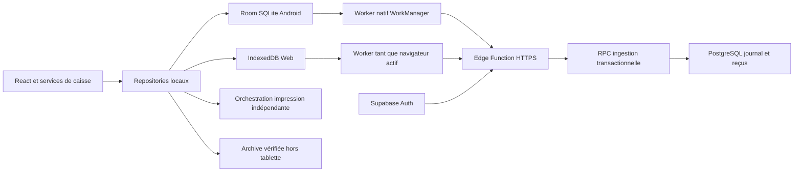
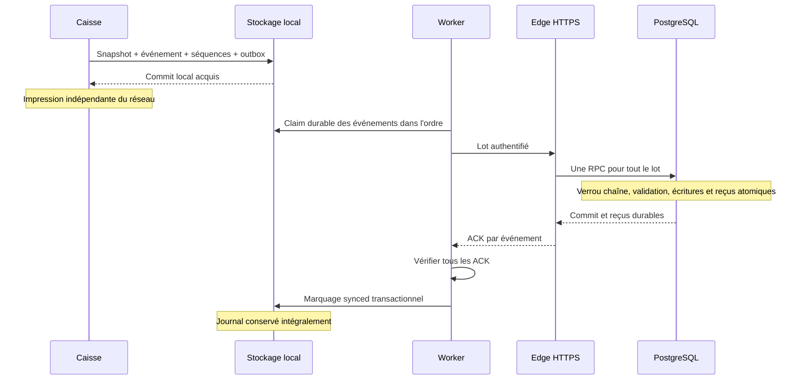

# Architecture Supabase et synchronisation offline-first

Version de décision : **1.0**, 14 octobre 2026. Contrat réseau : **samhain-sync/1**.
Statut : décisions techniques retenues pour [#111](https://github.com/Sylapho/samhain-pos/issues/111), à implémenter dans des issues séparées. Aucun serveur, schéma, migration, worker ou credential n'est créé par ce document.

## 1. Objectifs, périmètre et invariants

Room/SQLite reste la source de vérité locale Android ; IndexedDB conserve ce rôle sur le Web. Supabase reçoit une copie immuable du journal, et publiera le catalogue. Une vente, son paiement et le lancement de son impression n'attendent jamais le réseau. La synchronisation est différée et sa révocation ne bloque pas les ventes locales.

Décisions retenues : identité durable de chaîne distincte du terminal ; outbox atomique couvrant les cinq types financiers ; ingestion HTTPS par Edge Function authentifiée et unique RPC PostgreSQL transactionnelle ; ACK par événement ; aucune fusion automatique de chaînes. Aucun événement local n'est supprimé après ACK. `hash`, `previousHash`, `sequence`, identifiants, numéros et snapshots historiques ne changent jamais. Synchronisation et sauvegarde restent deux opérations distinctes.

Hors périmètre : implémentation, tables Supabase, migrations, nouvelles dépendances, nouvelle numérotation, paiement bancaire distant, multi-maître, certification, modification des prix/TVA/compositions/informations administratives et déploiement. Les rôles décrits sont des capacités techniques proposées, pas des règles d'exploitation déjà validées.

## 2. État actuel vérifié

Audit du checkout `0d788ec0c8ecdc8111925f395c6cdf9d09acdf23` ; l'issue cite un audit antérieur `914f88e523d7bf28d5d70c9f221b64192abfc0ed`. Les constats suivants viennent du code courant :

| Domaine         | Constat et référence                                                                                                                                                                                                                                                                                                                                                                                                                |
| --------------- | ----------------------------------------------------------------------------------------------------------------------------------------------------------------------------------------------------------------------------------------------------------------------------------------------------------------------------------------------------------------------------------------------------------------------------------- |
| Stockage        | [Fabrique](../src/services/orderRepositoryFactory.ts) : Android natif → `RoomOrderRepository`/bridge ; Web → `IndexedDbOrderRepository`. Pas de repli Android vers IndexedDB si Room échoue.                                                                                                                                                                                                                                        |
| Android         | [SamhainPosDatabase.kt](../native/android/SamhainPosDatabase.kt), Room v5 : `orders`, `order_printing`, `sales_ledger`, `pos_metadata`, `checkout_intents`, `products`, `catalog_metadata`. Migrations explicites 1→5, sans migration destructive.                                                                                                                                                                                  |
| Web             | [indexedDbSchema.ts](../src/services/indexedDbSchema.ts), IndexedDB v4 : commandes, états techniques, journal, métadonnées, intentions et catalogue.                                                                                                                                                                                                                                                                                |
| Commit          | [orderRepository.ts](../src/services/orderRepository.ts) et [RoomOrderStore.kt](../native/android/RoomOrderStore.kt) : snapshot, impression initiale, journal et séquences écrits atomiquement. Finalisation d'intention durable ; les changements d'impression restent séparés.                                                                                                                                                    |
| Journal         | [salesLedger.ts](../src/types/salesLedger.ts), schéma 1 : `sale`, `correction`, `closure`, `cash_session_opened`, `cash_float_updated`. Séquence globale à la base, commence à 1 ; tête globale, premier `previousHash = null`.                                                                                                                                                                                                     |
| Identité        | [terminalConfigurationService.ts](../src/services/terminalConfigurationService.ts) : configuration dans localStorage, UUID au provisioning/reprovisionnement, codes A/B/C/D. Renommer conserve l'UUID ; reprovisionner ne remet pas les séquences/journal à zéro. Aucun `chainId`, `organizationId` ou `festivalId` serveur aujourd'hui.                                                                                            |
| Catalogue       | [catalogRepository.ts](../src/services/catalogRepository.ts) et [catalogService.ts](../src/services/catalogService.ts) : Room/IndexedDB, seed si vide et non initialisé, validation et migrations locales de prix existantes. Produits modifiables localement, `active` et `availability` filtrent la vente. [Catégories](../src/types/catalog.ts) statiques ; disponibilité globale et rupture locale ne sont pas encore séparées. |
| Paiement/panier | [checkoutService.ts](../src/services/checkoutService.ts) persiste l'intention et son snapshot avant finalisation ; [cartStore.ts](../src/store/cartStore.ts) est en mémoire Zustand sans persistance. Une intention n'est pas une vente supplémentaire.                                                                                                                                                                             |
| Migration       | [roomOrderRepository.ts](../src/services/roomOrderRepository.ts) lit/vérifie l'ancien IndexedDB et l'importe atomiquement dans Room ; marqueur durable et reprise idempotente, anciennes données non effacées.                                                                                                                                                                                                                      |
| Archive         | `SalesArchive` v1 inclut commandes, journal, séquences, source, états d'impression et `archiveHash`, pas le catalogue, les intentions ni les credentials. Export vérifié ; restauration atomique exige commandes/journal vides. Ce n'est pas une copie complète de la tablette.                                                                                                                                                     |
| Remplacement    | [tabletReplacementService.ts](../src/services/tabletReplacementService.ts) : marqueur localStorage de reprise, restauration vérifiée puis adoption de l'identité ; ancienne tablette à isoler. Aucun contrôle de tête distante aujourd'hui.                                                                                                                                                                                         |
| Réseau/sécurité | Colonnes `orders.sync_*` présentes, sans outbox, moteur réseau ou WorkManager. PIN responsable local ≠ Auth serveur. Les politiques Android excluent sauvegarde cloud/D2D ; aucun mécanisme actuel ne détecte une tablette clonée distante.                                                                                                                                                                                         |

Le vérificateur distingue `valid` et `complete` : les ventes sans `integrity` sont legacy, non scellées, jamais scellées rétroactivement. Les corrections anciennes sans `refundLines` et clôtures sans session restent des formes historiques acceptées. Les calculs utilisent les snapshots historiques, jamais le catalogue courant.

Références locales : [persistance Android](android-persistence.md), [journal](sales-ledger.md), [sauvegarde/remplacement](tablet-replacement-and-backup.md), [validation](../src/services/orderValidation.ts), [remboursements](../src/services/saleRefund.ts).

## 3. Composants et flux cible





## 4. Matrice des données

`L` = stockage local durable, `S` = serveur. Conservation financière : aucune purge automatique locale ou distante ; durée légale/opérationnelle définitive à valider, sans introduire ici une nouvelle règle fiscale. Les reçus d'idempotence sont conservés aussi longtemps que les événements. Aucun délai de rétention technique ne permet de réutiliser une clé financière.

| Catégorie                | Autorité / sens cible                                      | Clé stable                                                    | Conflits                                                                          | Conservation                                                               | Hors connexion                                                           | Restauration                                                                                         |
| ------------------------ | ---------------------------------------------------------- | ------------------------------------------------------------- | --------------------------------------------------------------------------------- | -------------------------------------------------------------------------- | ------------------------------------------------------------------------ | ---------------------------------------------------------------------------------------------------- |
| Ventes                   | L → S, snapshot immuable                                   | périmètre + chaîne + `ledger.id` ; `order.id` pour vente      | même clé/contenu = replay ; différence = conflit                                  | financière, sans purge                                                     | commit local et impression                                               | backfill identique, pas de nouvelle vente                                                            |
| Corrections              | L → S                                                      | `ledger.id`, `correction.operationId`                         | dépendance vente ; delta/snapshot immuables                                       | financière                                                                 | append local                                                             | rejouer identiquement, conserver références legacy                                                   |
| Clôtures                 | L → S                                                      | `ledger.id`, `closure.operationId`                            | totaux contrôlés sur préfixe historique                                           | financière                                                                 | clôture locale                                                           | mêmes bornes/totaux, pas de recalcul substitué                                                       |
| Ouvertures de session    | L → S                                                      | `ledger.id`, `session.sessionId`                              | unicité et état de session par chaîne                                             | financière                                                                 | ouverture locale                                                         | reconstruire projection depuis journal                                                               |
| Fonds de caisse          | L → S                                                      | `ledger.id`, `cashFloatUpdate.operationId`                    | ancienne valeur/session contrôlées                                                | financière                                                                 | append local                                                             | aucun écrasement d'ouverture                                                                         |
| Produits                 | S publié → L ; propositions L → S séparées                 | périmètre + `Product.id`, révision publiée ; UUID proposition | publication avec révision attendue, conflit explicite ; pas de LWW                | versions publiées référencées et propositions conservées ; durée à valider | dernière version valide + édition locale tracée                          | archive v1 ne restaure pas catalogue ; réinstaller copie puis propositions récupérables séparément   |
| Catégories               | S publié → L à terme (#90/#115)                            | périmètre + catégorie ; aujourd'hui union statique            | refuser catégorie inconnue au client v1 ; ne pas supprimer référence d'un produit | historique des révisions ; durée à valider                                 | catégories connues disponibles                                           | indépendantes du journal, pas dans archive v1                                                        |
| Disponibilité globale    | S → L dans publication                                     | produit + révision globale                                    | serveur décide ; proposition locale distincte                                     | versions référencées ; durée à valider                                     | dernière information connue, sans prétendre connaître état global actuel | recharger après enrôlement                                                                           |
| Rupture locale           | L ; pas de propagation inter-caisses en v1                 | installation + produit + révision locale                      | overlay local, jamais effacé par publication                                      | jusqu'à levée explicite ; traces selon politique à valider                 | reste appliquée                                                          | absente de l'archive v1 ; contrôle opérateur, pas de remise en stock automatique annoncée            |
| Configuration terminal   | L pour code/nom ; registre S pour droit d'émettre          | `terminalId`, `installationId`, chaîne                        | mapping historique autorisé ; pas d'autorisation par simple UUID déclaré          | mappings aussi longtemps que journal ; configuration courante durable      | configuration locale utilisée                                            | identité reprise explicitement, nouvelles clés d'installation                                        |
| Identités/autorisations  | Supabase Auth + registre S ; S → état technique L          | `auth.uid`, organisation, festival, installation              | révocation serveur prime au réseau ; PIN indépendant                              | sessions jusqu'à expiration/révocation ; audit selon politique à valider   | ventes locales continuent ; échanges suspendus                           | aucun token/PIN dans archive, réauthentifier et réenrôler                                            |
| Impression               | L exclusivement en v1                                      | `orderId` + document                                          | compare-and-set et états partiels existants                                       | avec commandes et archive ; pas de purge par sync                          | transport USB indépendant                                                | conserver états, aucune impression déclenchée par backfill                                           |
| Panier/paiement en cours | L exclusivement                                            | lignes du panier ; `CheckoutIntent.id` durable                | reprise actuelle, aucun replay réseau de paiement                                 | panier en mémoire ; intentions sans nouvelle purge automatique             | workflow local inchangé                                                  | intentions absentes de l'archive v1 : vérification opérationnelle, ne pas déclarer paiement récupéré |
| Archives/sauvegardes     | copie vérifiée hors appareil ; aucun upload automatique v1 | `archiveId` + `archiveHash`                                   | fichiers immuables, jamais remplacement silencieux                                | politique de sauvegarde/comptable à valider, garder copies existantes      | export/restauration local possibles                                      | contrôle intégrité/base vide + règles de tête ci-dessous ; sync ≠ sauvegarde                         |

Disponibilité effective cible = `active` publié ET disponibilité globale autorisant la vente ET absence de rupture locale. Le `Product.availability` actuel ne permet pas de déduire l'origine : à l'enrôlement, classer explicitement les valeurs existantes, sans les transformer silencieusement en disponibilité globale. Le détail d'édition/publication appartient à #115 : copie de base, propositions et révision attendue doivent être conservées séparément. Les changements locaux ne sont pas écrasés par une publication. Aucun prix temporaire ne devient confirmé par synchronisation.

## 5. Identité de chaîne et enrôlement

Implémentation #114 : voir [la procédure d'enrôlement](tablet-enrollment.md). Room v6 porte `sync_identity`, Auth et transport sont natifs avec Keystore, et le registre impose invitations, génération et preuve de possession. Les headers de preuve complètent le corps `samhain-sync/1` sans modifier ses champs ni les payloads financiers. L'outbox #35, les transactions d'ingestion #36 et le parcours d'import #61 restent à intégrer.

`chainId` est un UUID technique durable généré une seule fois et stocké avec les métadonnées locales, dans une transaction ; ce champ est extérieur aux payloads scellés. Il désigne la succession globale du journal de cette base, pas une caisse A/B/C/D. Un reprovisionnement garde ce `chainId` et ses séquences. `terminalId` décrit l'identité métier au moment de chaque événement ; `installationId` identifie l'installation physique émettrice, renouvelée lors d'un remplacement. Aucune de ces chaînes de caractères seule ne prouve une autorisation.

Le registre serveur associe chaîne, organisation, festival, installation active, génération d'enrôlement et identités terminal historiques autorisées. Un mapping associe chaque terminal aux plages de séquences où il est observé, avec preuves d'archive/préfixe et validation administrative. Un terminal peut réapparaître dans plusieurs plages ; ne pas supposer une bijection ni une seule identité par chaîne. L'enveloppe de chaque événement garde son terminal source, même si l'installation courante a changé de terminal. L'UUID du terminal courant n'est jamais substitué dans l'outbox.

Le périmètre organisation/festival est assigné par enrôlement autorisé, pas déduit de `source.organization.eventName` ou d'un SIRET. La liaison d'une chaîne à ce périmètre est immuable en v1. Si une base historique couvre plusieurs éditions, conserver une association technique unique documentée ; la ventilation entre éditions nécessite validation séparée, sans découper ni réécrire la chaîne. Le démarrage d'une nouvelle édition ne réinitialise pas automatiquement la base.

Première activation sur une base existante : vérifier tout le journal, créer le `chainId` local et un dossier d'enrôlement contenant première empreinte, tête, séquence, identités historiques et inventaire legacy. Si le même préfixe existe déjà au serveur (restauration ou clone), le serveur propose la chaîne existante ; seul un responsable autorisé confirme le mapping. Ne pas créer une nouvelle chaîne pour contourner un conflit. Une base vide reçoit une nouvelle chaîne. Les événements créés avant authentification restent capturés ; le périmètre de transport est figé seulement après liaison approuvée.

Reprovisionnement cible : conserver les préconditions locales existantes (impression à reprendre) et ajouter le contrôle des envois en cours/en attente de #114. Ne pas imposer un appel réseau au checkout. Si un changement existe malgré une outbox non vidée (ancienne version/restauration), ses événements restent envoyables sous leurs identités historiques ; le mapping du nouveau terminal est une opération distincte. Un renommage n'invalide aucun ACK.

Deux installations ne peuvent être autorisées simultanément à prolonger la même chaîne. Le serveur garde une génération d'enrôlement monotone : remplacement contrôlé → retrait de l'ancienne installation → nouvelle génération. L'ancienne session ne peut plus uploader, même avec un JWT encore valide. Cette exclusion ne peut empêcher un appareil isolé de créer localement un fork : elle borne l'acceptation distante, sans bloquer les ventes hors ligne ni prétendre garantir l'unicité physique hors réseau.

## 6. Contrat samhain-sync/1

### 6.1 Endpoint, bornes et enveloppe

Cible : `POST /functions/v1/ledger-ingest-v1`, HTTPS, `Content-Type: application/json`, `Authorization: Bearer <JWT utilisateur>`, `apikey: <clé publishable>`. Pas de token dans le corps. Une requête contient une seule chaîne et un seul périmètre. Limites applicatives choisies : 100 événements, 1 048 576 octets UTF-8 pour le corps entier, 262 144 octets UTF-8 pour la valeur décodée de `payloadCanonical` (le corps JSON échappé reste soumis à sa propre limite). Aucun gzip en v1. Une entrée indivisible trop grande est mise en intervention, jamais découpée en faux événements. Un 413 sur un lot peut conduire à le réduire jusqu'à un événement.

Champs obligatoires de requête : `protocolVersion: 1`, `requestId` UUID par tentative, `organizationId`, `festivalId`, `chainId`, `installationId`, `enrollmentGeneration` entier positif, `expectedHead: {sequence, hash}`, `events`. Tête vide : `{sequence: 0, hash: null}`. `expectedHead` est la tête connue avant le premier événement nouveau du lot ; pour un retry identique, elle reste celle de l'envoi perdu. Une nouvelle tentative peut changer `requestId`, jamais le contenu des événements. L'heure d'envoi n'est pas utilisée pour ordonner.

Chaque événement porte :

| Champ                              | Règle                                                                                                                                           |
| ---------------------------------- | ----------------------------------------------------------------------------------------------------------------------------------------------- |
| `eventId`                          | identique à `SalesLedgerEntry.id`, opaque non vide ; ne pas exiger UUID ni reconstruire à partir du numéro affiché                              |
| `eventType`                        | `ledger` en v1 pour les cinq kinds                                                                                                              |
| `ledgerSchemaVersion`              | 1 ; distinct de version du protocole                                                                                                            |
| `sourceTerminalId`                 | exactement `payload.source.terminal.terminalId`, identité historique enregistrée                                                                |
| `sequence`, `hash`, `previousHash` | exactement ceux du ledger ; hash SHA-256 hex minuscule de 64 caractères                                                                         |
| `ledgerCanonicalization`           | `ts-ledger-v1` ou `android-ledger-v1`, profil original qui reproduit l'empreinte                                                                |
| `payloadCanonical`                 | chaîne JSON canonique contenant **l'entrée complète, y compris hash** ; tous les champs historiques conservés, aucune insertion de champ absent |
| `transportFingerprint`             | SHA-256 selon §6.2 ; distinct de l'empreinte financière                                                                                         |

Les UUID de périmètre/chaîne/installation sont techniques ; les IDs historiques sont opaques. Toutes les longueurs de clés opaques sont bornées à 512 octets UTF-8 pour le transport v1 ; une valeur historique hors borne exige intervention, sans troncature. Dates historiques et noms ne sont pas normalisés ni utilisés comme clés serveur. Traçabilité serveur : sujet Auth vérifié, installation/génération, requestId, première réception UTC, version protocole/profil, périmètre et résultat. Ne pas inventer un identifiant de caissier historique : le sujet qui transmet peut différer de l'opérateur qui a vendu.

### 6.2 Canonicalisation et empreintes

Le hash financier reste `SHA256(canonical(entry sans le champ hash))`, UTF-8, tel que calculé à l'origine par [integrity.ts](../src/utils/integrity.ts) ou [CanonicalJson.kt](../native/android/CanonicalJson.kt). Les deux trient les clés et conservent l'ordre des tableaux, mais **leur équivalence sur tout JSON n'est pas démontrée** : TypeScript utilise `JSON.stringify` pour nombres/chaînes, Kotlin `BigDecimal.stripTrailingZeros().toPlainString()` et `JSONObject.quote`. Notamment nombres exponentiels et certains échappements peuvent différer. Ne pas remplacer ces algorithmes par JSONB texte ou RFC 8785 et ne jamais recalculer un nouveau hash historique pour obtenir l'égalité.

Pour un événement existant, chercher le profil qui reproduit le hash stocké sur l'entrée sans hash. Si les deux donnent la même représentation, `ts-ledger-v1` est toujours la convention de transport, y compris après migration/restauration. Sinon retenir uniquement le profil qui reproduit le hash ; la source attestée permet de diagnostiquer une incompatibilité. Si aucun ne correspond, bloquer l'envoi et vérifier l'intégrité. Un historique migré peut contenir les deux profils ; `source.buildMode` seul ne suffit pas à choisir. Le serveur reproduit le profil déclaré, compare `payloadCanonical` à la représentation complète correspondante, puis recalcule le hash sans hash. Conserver la chaîne canonique originale en plus d'une projection JSONB : JSONB n'est pas une preuve des octets originaux.

Les profils du ledger sont figés par le code référencé et devront avoir des vecteurs de conformité TS/Kotlin/serveur dans #36 : null/champ absent, ordre des clés UTF-16, tableaux, accents, emoji, guillemets, antislash, contrôles, slash après `<`, U+2028/U+2029, limites d'entiers. Les encodages non reproductibles sont des rejets explicites, pas une conversion silencieuse. Les nombres financiers sont des entiers sûrs (`abs <= 9007199254740991`), conformément aux validations existantes ; nombres non finis, clés JSON dupliquées, UTF-8 invalide et surrogates isolés sont refusés. Ne pas ajouter ces restrictions rétroactivement à une archive : son import réseau peut nécessiter une intervention tout en restant conservée localement.

La canonicalisation de transport **transport-json-v1** est indépendante : objets triés par unités UTF-16, tableaux dans leur ordre, aucune espace, champs optionnels absents omis, null explicite conservé. Nombres uniquement entiers sûrs, base 10 sans exposant ni zéros superflus (`-0` devient `0`). Chaînes : mêmes règles que `JSON.stringify` sur Unicode valide : échapper `"`, `\`, backspace/form-feed/newline/return/tab avec leurs échappements courts, autres U+0000–001F en `\u00xx` minuscule ; ni slash, ni accents, ni U+2028/U+2029 échappés, aucun NFC/NFD. Kotlin doit reproduire cette règle dédiée, **pas employer aveuglément `JSONObject.quote`**. SHA-256 des octets UTF-8, sans BOM ni newline final, hex minuscule.

L'objet exact empreinté est `{protocolVersion, organizationId, festivalId, chainId, eventId, eventType, ledgerSchemaVersion, sourceTerminalId, sequence, hash, previousHash, ledgerCanonicalization, payloadCanonical}`. Aucun autre champ. `installationId`, génération, requestId, token, tentatives, dates techniques et ACK sont exclus pour permettre un remplacement/retry. Le fingerprint est calculé une fois après liaison du périmètre et conservé dans l'outbox ; il est recalculé par le serveur. Un fingerprint ne prouve ni identité ni authenticité sans autorisation serveur.

### 6.3 Types financiers et dépendances

| Kind / identité actuelle                                 | Payload métier à conserver et contrôle                                                                                                                                                                                                                     |
| -------------------------------------------------------- | ---------------------------------------------------------------------------------------------------------------------------------------------------------------------------------------------------------------------------------------------------------- |
| `sale` / `sale:<order.id>`                               | `orderId`, `order: ImmutableOrderSnapshot` : pas de `printing` ni `integrity` dans `order`. Valider lignes, options, quantités, cents/totaux, paiement `card/cash`, `paid`, dates et terminal. Projection commande issue de ce snapshot uniquement.        |
| `correction` / `correction:<operationId>`                | `correction` complet, références d'origine et `originalSaleHash`, type cancellation/refund/adjustment ; `refundLines` optionnel historique. Vente antérieure ou legacy déjà importée obligatoire ; vérifier règles/deltas et quantités sur état précédent. |
| `closure` / `closure:<operationId>`                      | `closure` avec période et `totals`, champs session/fond optionnels historiques ; calculs du préfixe précédent, intervalle demi-ouvert et cumul conformément au code local.                                                                                 |
| `cash_session_opened` / `cash-session:<sessionId>`       | `session` avec sessionId, periodStart, openingFloatCents, createdAt ; unicité/session active selon règles existantes.                                                                                                                                      |
| `cash_float_updated` / `cash-float-update:<operationId>` | `cashFloatUpdate` avec opération, session, ancien/nouveau fond, updatedAt ; session active et ancienne valeur attendue.                                                                                                                                    |

Ces préfixes décrivent les producteurs actuels, ils ne sont pas un parseur d'identité serveur. Unicités serveur : `(organizationId, festivalId, chainId, eventId)`, même périmètre/chaîne/sequence ; vente par `orderId`, opérations par kind/operationId, ouverture par sessionId dans cette chaîne. Une réutilisation de `order.id` dans une autre chaîne du même périmètre est signalée et soumise à résolution, pas comptée comme une nouvelle vente. Les numéros imprimés ne sont pas uniques globalement entre chaînes et ne sont pas renumérotés.

### 6.4 Transaction, ordre et idempotence

1. Authentifier, borner/parser le corps, vérifier version, périmètre et profils, recalculer empreintes. La RPC revalide les contraintes et règles critiques ; pas de confiance dans un hash envoyé.
2. Dans une seule transaction, verrouiller la ligne de tête de chaîne et le registre d'enrôlement/autorisation actif. Une révocation concurrente et l'ingestion sont sérialisées : si la révocation est committée en premier, aucun nouvel événement accepté. Sinon le commit financier déjà acquis reste valide.
3. Le lot est trié strictement par `sequence`, sans doublon interne. Les replays sont un préfixe contigu déjà enregistré ; chaque replay doit avoir mêmes ID, payload, profil, hash et fingerprint. Une différence annule le lot entier. La comparaison de contenu protège aussi contre un hash mensonger.
4. Pour les nouveaux événements, `expectedHead` doit correspondre à la tête sous verrou. Chaque séquence est tête+1 et `previousHash` égale la tête (null seulement au premier événement). Les dépendances sont résolues dans le préfixe durable ou plus tôt dans le même lot. Aucun événement manquant n'est sauté.
5. Insérer tous les événements nouveaux, snapshots/projections nécessaires, reçus durables et nouvelle tête dans cette transaction. Une erreur quelconque annule toutes les nouvelles écritures du lot. Les replays déjà durables ne sont évidemment pas supprimés.
6. Retourner les reçus seulement après commit. Lot entièrement replayé : renvoyer les reçus existants même si `expectedHead` est ancienne, sans avancement. Lot mixte replay/nouveaux : exiger une tête correspondant au préfixe déjà durable avant ses nouveaux événements ; une concurrence différente renvoie `HEAD_MOVED`.

Deux chaînes distinctes progressent en parallèle. Pour une même chaîne, le verrou et les unicités sérialisent ; un retry exact reste sûr. Pas de série d'insertions HTTP, de LWW financier, de validation fondée sur l'heure serveur ou le catalogue actuel. Une lacune retourne la prochaine séquence/hash attendus pour réenvoyer le préfixe. Un client moins avancé ne peut faire reculer la tête serveur. Priorité déterministe après Auth/schéma/empreintes : conflit de clé ou séquence déjà occupée → conflit permanent ; première nouvelle séquence supérieure à tête+1 → MISSING_PREDECESSOR ; séquence suivante valide mais expectedHead obsolète → HEAD_MOVED ; dépendance métier absente → DEPENDENCY_MISSING. expectedHead absent au diagnostic avant enrôlement ne vaut jamais autorisation d'ingestion.

## 7. ACK et erreurs

### 7.1 Reçu par événement

HTTP 200 : `{protocolVersion, requestId, organizationId, festivalId, chainId, committed: true, serverHead: {sequence, hash}, acknowledgements: [...]}`. Chaque ACK contient `eventId`, `sequence`, `hash`, `transportFingerprint`, `receiptId` UUID serveur, `serverReceivedAt` ISO UTC de **première** réception et `status: accepted | already_present`. Le reçu persistant ne change pas au retry ; seul status peut devenir already_present et requestId reflète la tentative courante. La tête peut être plus avancée pour un lot déjà présent.

Le client vérifie TLS/endpoint attendu, HTTP 200, protocole exactement 1, requestId de la tentative, committed, périmètre/chaîne, **bijection** entre ACK et événements envoyés (aucun absent/étranger/doublon), sequence/hash/fingerprint exacts, status appartenant à accepted/already_present, format receiptId et date UTC valide. Vérifier aussi les entiers sûrs et formats SHA-256 de la réponse. Tête ≥ dernière séquence acquittée ; si même séquence, hash identique. Une tête supérieure est informative, jamais une autorisation d'adopter ses données localement. Le client ne peut prouver un commit PostgreSQL par le JSON seul : cette garantie relève du serveur authentifié et des tests de transaction.

Seulement après ces contrôles, transaction locale pour conserver les reçus et marquer tout le lot `synced`, sous vérification de l'identité/fingerprint des lignes claimées. Aucun ACK invalide ne marque quoi que ce soit. Crash avant/après cette transaction : état pending/sending repris, retry identique → already_present. Une réponse tronquée, partielle ou 207 n'est pas un succès v1 ; retransmettre. V1 interdit le commit partiel : les erreurs ne comportent aucun ACK positif du lot rejeté. `serverReceivedAt` ne remplace jamais `recordedAt`, `createdAt` ou `paidAt`.

### 7.2 Erreurs structurées

Format : `{protocolVersion: 1, requestId, error: {code, category, retryable, eventId?, expectedHead?, retryAfterSeconds?}}`. `category` appartient à `temporary`, `auth`, `recovery`, `permanent`. Pas de payload financier ou token dans les logs. Si rejet avant parsing/auth gateway et absence de JSON contractuel, se fier au HTTP pour pause/retry ; jamais inventer un ACK.

| HTTP / code                                                                                               | Catégorie                           | Action                                                                                        |
| --------------------------------------------------------------------------------------------------------- | ----------------------------------- | --------------------------------------------------------------------------------------------- |
| timeout, DNS, 408 / NETWORK_ERROR                                                                         | temporary, retryable                | retry identique après backoff ; résultat serveur inconnu                                      |
| 429 / RATE_LIMITED ; 502/503/504 / SERVER_UNAVAILABLE ; 500 / INTERNAL_ERROR                              | temporary, retryable                | respecter Retry-After puis retry ; incident serveur ne bloque pas vente                       |
| 503 / TRANSACTION_RETRY                                                                                   | temporary, retryable                | deadlock/serialization : transaction annulée, retry borné serveur puis client                 |
| 401 / AUTH_REQUIRED                                                                                       | auth, non retryable automatiquement | refresh sérialisé une fois ; sinon pause jusqu'à réauthentification                           |
| 403 / ACCESS_REVOKED, SCOPE_DENIED, INSTALLATION_RETIRED                                                  | auth, non retryable                 | pause réseau, conserver file ; intervention autorisée, ventes continuent                      |
| 409 / HEAD_MOVED                                                                                          | recovery, non retryable aveuglément | relire tête et comparer préfixe, ajuster curseur après preuve ; pas de fusion                 |
| 409 / MISSING_PREDECESSOR, DEPENDENCY_MISSING                                                             | recovery                            | backfill événement/vente legacy manquant, puis même envoi ; ne pas sauter                     |
| 409 / EVENT_CONTENT_CONFLICT, SEQUENCE_FORK, DUPLICATE_ORDER_OTHER_CHAIN                                  | permanent                           | quarantaine de la chaîne réseau et dossier d'incident ; aucune réécriture                     |
| 413 / BATCH_TOO_LARGE                                                                                     | recovery                            | réduire lot ; entrée seule trop grande → permanent EVENT_TOO_LARGE                            |
| 400 / INVALID_ENVELOPE ; 422 / INVALID_HASH, INVALID_FINGERPRINT, INVALID_PAYLOAD, BUSINESS_INCONSISTENCY | permanent                           | isoler erreur, conserver données ; correction logicielle/opérateur sans réécriture historique |
| 422 / CANONICALIZATION_UNSUPPORTED                                                                        | permanent                           | profil original non reproductible : intervention, pas de rehash                               |
| 426 / PROTOCOL_UNSUPPORTED ; 422 / LEDGER_SCHEMA_UNSUPPORTED                                              | recovery                            | pause jusqu'à mise à jour compatible, conserver file                                          |

`retryable` signifie autoriser un retry automatique sans changement d'état externe ; les recoveries demandent un rapprochement/changement de lot/version. Une erreur permanente sur le premier événement empêche l'envoi de ses successeurs, mais pas les futurs commits locaux. Les diagnostics exposeront l'état distinct d'une erreur de caisse (#116).

## 8. Exemples JSON et vecteurs

Exemple technique synthétique : ouverture avec zéro fond (valeur autorisée par le code, pas une règle commerciale). Les UUID et dates servent uniquement de fixture. La source administrative ci-dessous copie la configuration actuelle du dépôt sans la confirmer par cette décision. `payloadCanonical` est une chaîne pour préserver sa représentation ; elle se parse en `CashSessionOpenedLedgerEntry` réel.

<!-- sync-request-example -->

```json
{
  "protocolVersion": 1,
  "requestId": "66666666-6666-4666-8666-666666666666",
  "organizationId": "33333333-3333-4333-8333-333333333333",
  "festivalId": "44444444-4444-4444-8444-444444444444",
  "chainId": "55555555-5555-4555-8555-555555555555",
  "installationId": "77777777-7777-4777-8777-777777777777",
  "enrollmentGeneration": 1,
  "expectedHead": {
    "sequence": 0,
    "hash": null
  },
  "events": [
    {
      "eventId": "cash-session:22222222-2222-4222-8222-222222222222",
      "eventType": "ledger",
      "ledgerSchemaVersion": 1,
      "sourceTerminalId": "11111111-1111-4111-8111-111111111111",
      "sequence": 1,
      "hash": "e53895301353b929950ef64ed9275039bd2c4d98a04e2dc2cabdd74582d0b0b5",
      "previousHash": null,
      "ledgerCanonicalization": "ts-ledger-v1",
      "payloadCanonical": "{\"hash\":\"e53895301353b929950ef64ed9275039bd2c4d98a04e2dc2cabdd74582d0b0b5\",\"id\":\"cash-session:22222222-2222-4222-8222-222222222222\",\"kind\":\"cash_session_opened\",\"previousHash\":null,\"recordedAt\":\"2026-10-14T08:00:00.000Z\",\"schemaVersion\":1,\"sequence\":1,\"session\":{\"createdAt\":\"2026-10-14T08:00:00.000Z\",\"openingFloatCents\":0,\"periodStart\":\"2026-10-14T08:00:00.000Z\",\"sessionId\":\"22222222-2222-4222-8222-222222222222\"},\"source\":{\"buildMode\":\"production\",\"organization\":{\"address\":\"24 rue Alsace Lorraine 27300 Bernay\",\"city\":\"Bernay\",\"eventName\":\"Samhain\",\"organizationName\":\"Association Les Trouble-fêtes\",\"siret\":\"923 116 628 00028\",\"usesDemoPlaceholders\":false,\"vatNumber\":\"FR90 923116628\"},\"softwareVersion\":\"1.0.0\",\"terminal\":{\"displayName\":\"Caisse A\",\"terminalCode\":\"A\",\"terminalId\":\"11111111-1111-4111-8111-111111111111\"}}}",
      "transportFingerprint": "bf1a397bc85b48a0a853179fdfe9e6d6059cf1c2f66ff78ba0128277fd09866a"
    }
  ]
}
```

<!-- sync-ack-example -->

```json
{
  "protocolVersion": 1,
  "requestId": "66666666-6666-4666-8666-666666666666",
  "organizationId": "33333333-3333-4333-8333-333333333333",
  "festivalId": "44444444-4444-4444-8444-444444444444",
  "chainId": "55555555-5555-4555-8555-555555555555",
  "committed": true,
  "serverHead": {
    "sequence": 1,
    "hash": "e53895301353b929950ef64ed9275039bd2c4d98a04e2dc2cabdd74582d0b0b5"
  },
  "acknowledgements": [
    {
      "eventId": "cash-session:22222222-2222-4222-8222-222222222222",
      "sequence": 1,
      "hash": "e53895301353b929950ef64ed9275039bd2c4d98a04e2dc2cabdd74582d0b0b5",
      "transportFingerprint": "bf1a397bc85b48a0a853179fdfe9e6d6059cf1c2f66ff78ba0128277fd09866a",
      "receiptId": "88888888-8888-4888-8888-888888888888",
      "serverReceivedAt": "2026-10-14T09:00:00.000Z",
      "status": "accepted"
    }
  ]
}
```

Les empreintes de ces exemples sont calculées avec `integrity.ts` sur les représentations décrites au §6.2. Un serveur conserve également la représentation complète de l'entrée et construit les projections séparément ; l'ACK n'est pas ajouté au payload du ledger.

## 9. Architecture Supabase et sécurité

| Aspect                | A. Edge HTTPS + RPC transactionnelle                                                                                         | B. RPC PostgreSQL directement via HTTPS                                                                       |
| --------------------- | ---------------------------------------------------------------------------------------------------------------------------- | ------------------------------------------------------------------------------------------------------------- |
| Sécurité              | filtre taille/protocole/JWT et erreurs stables ; RPC fermée au client ; autorisations explicites avec chemin privilégié      | moins de composants ; accès EXECUTE/RLS/definer et validation exhaustive doivent protéger chaque appel direct |
| Atomicité/idempotence | une RPC par lot, verrou/tête/reçus dans PostgreSQL                                                                           | mêmes garanties si une seule RPC ; aucune garantie avec appels d'insertion séparés                            |
| Maintenance           | contrat indépendant des tables, profils de canonicalisation plus faciles à reproduire ; déploiement Edge et SQL à coordonner | SQL central, moins de déploiements ; parsing/profils/HTTP moins simples à faire évoluer                       |
| Erreurs               | mapping contrôlé vers codes v1, gateway à prendre en compte                                                                  | adapter erreurs PostgREST et SQL au contrat sans exposer détails                                              |
| Android/Web           | HTTPS JSON commun, CORS autorisé sur origines Web configurées                                                                | HTTPS JSON commun également ; pas de connexion PostgreSQL native                                              |
| Évolutivité           | validation en bordure et transaction bornée, pas de microservice supplémentaire                                              | ingestion centralisée DB ; coût de validation à mesurer                                                       |
| Simplicité            | un composant supplémentaire, mais frontières lisibles pour #35/#36                                                           | meilleur minimum de composants, exige forte discipline SQL et de grants                                       |

**Décision A** : Edge Function utilisateur authentifié pour frontière HTTP/version et canonicalisation ; une RPC atomique serveur pour validation durable, permissions, concurrence, écritures et reçus. Ce choix facilite les profils TS/Kotlin et le contrat d'erreur sans exposer les tables financières. L'Edge n'est ni un worker persistant ni la transaction elle-même.

Auth : JWT Supabase utilisateur vérifié (signature, issuer, audience, expiration), contrôle de session/utilisateur actif pour accès réseau et registre de capacités consulté à chaque ingestion. Une clé publishable identifie le composant public, pas un utilisateur ; `secret`/`service_role` exclusivement dans secrets serveur. Voir [clés officielles](https://supabase.com/docs/guides/getting-started/api-keys) et [auth Edge](https://supabase.com/docs/guides/functions/auth). Conserver la vérification JWT pour fonctions utilisateur ; ne pas désactiver un contrôle pour résoudre un 401.

L'Edge appelle la RPC avec credential serveur et sujet Auth **dérivé du JWT vérifié**, jamais du body. Ce chemin contourne RLS : la RPC doit donc recontrôler organisation/festival, membership actif, installation/génération, chaîne et identités historiques autorisées dans la transaction. Toute fonction d'ingestion/enrôlement privilégiée retire EXECUTE à PUBLIC/anon/authenticated et n'accorde que le rôle serveur requis. Pas de `security definer` public accessible qui puisse contourner cette frontière. Fonction invoker privilégiée préférée ; si definer nécessaire, propriétaire limité, `search_path = ''`, relations qualifiées et grants minimaux, selon [fonctions PostgreSQL Supabase](https://supabase.com/docs/guides/database/functions).

Tables financières/registre dans schéma privé non exposé ; pas de grants directs d'insertion/mise à jour/suppression client. Si des lectures/projections sont exposées, activer RLS par organisation/festival et membership actif, grants limités, sans lecture anonyme. Le filtre organisation envoyé par le client ne suffit pas. Protéger vues et fonctions également. [RLS Supabase](https://supabase.com/docs/guides/database/postgres/row-level-security) décrit cette séparation entre grants et policies. Tester accès inter-organisations, ancienne installation, terminal forgé, RPC directe et accès table contournant Edge.

Capacités techniques proposées : émetteur enrôlé → uploader sa chaîne et lire catalogue publié ; responsable serveur → enrôler/remplacer et approuver mappings dans son périmètre ; éditeur catalogue → proposer/publier selon droits ; auditeur → lecture seule journal/reçus du périmètre. L'uploader peut transmettre une correction autorisée **localement** sans prétendre que l'utilisateur Auth actuel a réalisé la correction historique. L'attribution des rôles, comptes et contrôles supplémentaires reste à valider. Le PIN local n'obtient aucun JWT ni droit serveur.

Migrations serveur futures versionnées et revues, environnements de test/production séparés, pas de changement manuel non tracé en production : [migrations Supabase](https://supabase.com/docs/guides/deployment/database-migrations). Aucune migration dans #111.

## 10. Outbox et exécution différée (#35)

Tout commit réel de chacun des cinq kinds crée une ligne outbox dans **la même transaction** que le ledger/projections/séquences, même si synchronisation désactivée ou non enrôlée. Les replays métier réutilisent l'événement existant. Capture locale : chainId, eventId, payload original figé/profil/hash, sequence, état ; après enrôlement : périmètre et fingerprint figés. Contraintes locales par chaîne/eventId ; index état/nextAttemptAt.

États techniques : `pending`, `sending` (claim expirant), `synced`, `paused_auth`, `needs_recovery`, `quarantined`. Conserver tentatives, nextAttemptAt, lastAttemptAt, lastError, reçu et bail/owner. Séparer ces données du payload financier. Les anciennes colonnes sync des commandes deviennent une projection technique, pas la file de référence. Capture et marquage ACK sont durables ; échec transactionnel d'outbox annule le commit concerné comme toute erreur de stockage, sans dépendance réseau.

Un seul worker utile par chaîne : claim durable dans transaction, bail 120 secondes renouvelable, timeout HTTP 30 secondes. Après crash, bail expiré récupérable ; deux envois malgré un bail expiré restent idempotents au serveur. Refresh Auth sérialisé entre worker/relance. Retry avec full jitter sur `[0, min(6 heures, 5 secondes × 2^n)]`, n=0 au premier échec transitoire ; stocker le prochain instant, respecter Retry-After valide, ne pas retenter en boucle hors connexion. Réinitialiser compteur après succès ; retour réseau/relance peut réveiller le worker sous le même claim, sans contourner Auth/quarantaine. Horloge corrigée : reborner délais techniques, jamais dates financières.

**Android : WorkManager retenu pour #35**, tâche unique par chaîne avec contrainte réseau et drain borné, reschedulée tant que pending. Outbox Room est la file fiable ; planifier après commit et rescanner au démarrage couvre la fenêtre commit→planification. WorkManager offre du travail persistant différé, pas un délai garanti ; contraintes système, force-stop et restrictions OEM peuvent retarder jusqu'à la réouverture. Voir [documentation Android](https://developer.android.com/develop/background-work/background-tasks/persistent). Ne pas appeler le worker depuis le cycle React pour garantir la reprise.

Credentials Android (#114) : Auth et transport natifs, refresh/access token hors localStorage/WebView, fichier privé chiffré par clé Android Keystore non exportable ; accès via service natif limité à auth/état/relance, jamais getter de token vers JavaScript. Keystore protège les clés, pas le token magiquement : chiffrement authentifié, IV distinct et corruption/clé perdue → réauthentification. Exclure données/credentials des archives et backups/D2D, ne pas copier clés au remplacement. Voir [Keystore Android](https://developer.android.com/privacy-and-security/keystore). La mémoire native contient temporairement le token ; root/compromission de processus n'est pas résolue par ce choix. Le flux de connexion/deep link et la rotation de session relèvent de #114.

**Web :** transactions IndexedDB de capture et ACK avec mêmes règles ; drain dans contexte actif (worker possible), verrou durable commun entre onglets. Un service worker/Background Sync ne garantit pas l'exécution navigateur fermé et n'est pas une exigence v1. Reprise à l'ouverture et au retour réseau, aucune attente checkout. Pas de promesse de sécurité équivalente au Keystore : session en mémoire par défaut, réauthentification après fermeture ; stratégie de persistance Web à valider dans #114. Aucune clé privilégiée, protections XSS/CSP et CORS ; CORS n'est pas l'autorisation.

## 11. Backfill, legacy, forks et restaurations

### 11.1 Journal existant et legacy

Backfill de toutes les entrées scellées par lots locaux de 100, curseur durable et insertion idempotente dans transaction ; recouvrir nouvelles écritures pendant le rattrapage grâce à unicité et lecture sous transaction. Garder sequence/hash/payload/profil existants ; envoyer depuis séquence 1 sans re-sceller. Activation tardive et restauration reconstruisent les entrées outbox, jamais un paiement. Aucun ancien ACK d'archive n'est supposé fiable : revalider par replay serveur. Le journal financier reste présent après succès.

Ventes legacy sans `integrity` : voie distincte `POST /functions/v1/legacy-import-v1`, même Auth/périmètre/chainId/installation/génération, limites et transaction atomique ; `eventType: legacy_order`, `eventId = order.id`, `ledgerSchemaVersion: null`, `sequence/hash/previousHash: null`, `ledgerCanonicalization: null`, payload = `toImmutableOrderSnapshot(order)` en transport-json-v1. Empreinte suivant §6.2 avec ces nulls, registre legacy séparé, ACK avec sequence/hash nulls et fingerprint/receiptId/date ; pas de tête avancée. Requête legacy sans expectedHead et tableau events de ventes legacy ; réponse de même forme que §7 avec serverHead courant inchangé, sequence/hash nulls attendus dans chaque ACK. Les contrôles de bijection/périmètre/fingerprint restent obligatoires, sans comparaison numérique sur une sequence null. Unicité par périmètre/chaîne/orderId, conflit de contenu explicite et contrôle de doublon inter-chaînes. Ces données sont marquées **non scellées** ; ne pas fabriquer `sale:<id>`, séquence ou date de scellement. Les éventuelles corrections scellées de ces ventes restent dans le ledger avec `originalSaleHash: null` historique.

Importer l'inventaire legacy avant les événements du ledger qui y font référence ; dépendance manquante = recovery, pas suppression. Ne pas additionner les ventes legacy aux totaux de clôture du ledger si le calcul local les exclut : le serveur réplique les calculs existants. Toute restitution distingue couverture legacy, journal scellé et complétude ; aucune TVA historique absente n'est devinée.

### 11.2 Identifier une divergence

Comparer sous autorisation les `(sequence, eventId, hash, fingerprint)` des préfixes, pas seulement les têtes. Même sequence avec contenu/ID/hash différent, même eventId avec autre contenu ou même previousHash avec deux successeurs incompatibles = fork. Même tête avec nouvelles métadonnées d'installation n'est pas un fork. Même eventId/hash mais autre payload/fingerprint = conflit, même si hash déclaré identique.

Cible de diagnostic : `POST /functions/v1/ledger-prefix-v1` avec protocole, requestId, périmètre/chaîne/installation/génération et jusqu'à 100 `{sequence, eventId, hash, transportFingerprint}` locaux ; réponse authentifiée écho du contexte, `serverHead` et résultat pour chaque tuple `match | absent | conflict`, plus tuple serveur sur conflit. Aucune écriture financière ni ACK implicite. Pour une archive sans fingerprint, recalculer à partir du mapping vérifié avant comparaison. Pagination continue du préfixe jusqu'au premier écart ; la tête seule n'autorise aucune reprise.

Quarantaine de la synchronisation de chaîne, conservation des deux journaux et archives, incident avec premier écart, installation/générations et dernières têtes communes. Serveur conserve la branche déjà acceptée, sans suppression/troncation. Responsable examine les preuves et ventes réellement encaissées ; aucune fusion/re-numérotation/re-hash automatique, aucune réaffectation du suffixe à un autre chainId pour le faire accepter. Traitement comptable d'une branche orpheline et éventuelle ingestion d'exception requièrent une décision métier et un futur protocole. Les ventes locales restent acquises et exportables, sans prétendre que la chaîne est synchronisée.

### 11.3 Restauration et remplacement

Les archives v1 n'ont pas de chainId. Ne jamais leur ajouter un champ sous le même archiveHash. En #112/#113, prévoir archive future versionnée avec métadonnées techniques de chaîne/mapping séparées des entrées financières ; garder lecture/vérification v1. Une v1 est liée à une chaîne via préfixe vérifié et registre/dossier d'enrôlement, jamais par `archive.source.terminalId` seul. Si aucun événement scellé n'existe, rapprochement manuel à partir inventaire legacy et dossier d'archive ; ambiguïté → attente d'enrôlement, pas choix automatique. Sans serveur, préserver les preuves et mapping disponible, pas une fausse vérification distante.

| Relation entre archive locale et serveur                               | Décision                                                                                                                                                                               |
| ---------------------------------------------------------------------- | -------------------------------------------------------------------------------------------------------------------------------------------------------------------------------------- |
| Serveur vide, chaîne non enregistrée                                   | enrôlement approuvé et backfill depuis 1, legacy d'abord ; aucun effacement                                                                                                            |
| Même préfixe et même tête                                              | retrait ancienne installation, nouvelle génération, replay/backfill puis reprise réseau                                                                                                |
| Local plus avancé, préfixe commun exact                                | envoyer suffixe pending dans l'ordre sous nouvelle autorisation                                                                                                                        |
| Serveur plus avancé, archive exacte mais ancienne                      | aucun recul serveur ; les anciens événements obtiennent already_present. Local manque le suffixe : état needs_recovery, ne pas prolonger volontairement cette identité connue obsolète |
| Écart au préfixe ou ventes locales nouvelles à séquences déjà occupées | fork/quarantaine, jamais fusion automatique                                                                                                                                            |
| Serveur inaccessible au remplacement                                   | restauration locale possible suivant runbook ; état serveur inconnu explicite, aucun marquage synced ni garantie de continuation sans fork                                             |

Pour tête distante avancée : obtenir une archive complète vérifiée de l'ancienne tablette ou une procédure de récupération contrôlée produisant un **snapshot complet** (journal, commandes, séquences, états techniques traités explicitement) ; restaurer dans une base vide selon les garde-fous existants. Aucun téléchargement de suffixe n'est fusionné automatiquement dans une base ayant reçu des ventes. La récupération serveur en archive n'est pas implémentée ici et ne pourra pas restituer états d'impression/intentions/catalogue absents côté serveur. Ne pas reprendre en supposant que tous les tickets ont été imprimés.

Si récupération complète impossible ou nécessité de vendre sans réseau : responsable peut préparer une caisse distincte avec **nouvelle base vide et identité**, après conservation de l'archive ancienne hors tablette et retrait opérationnel de l'ancienne caisse. Ce n'est pas une migration automatique/destructive ni une façon de déplacer le suffixe existant. Les numéros de la chaîne ancienne restent inchangés. La procédure opérationnelle et les conditions de cette reprise sont à valider (#61/#114). La synchronisation ne bloque jamais une caisse locale ; l'impossibilité de prolonger sûrement une copie ancienne est un problème de récupération déjà distinct des ventes ordinaires hors connexion.

Si une version actuelle reprend hors ligne sur archive ancienne avant rapprochement, conserver toutes ses ventes ; à la reconnexion le serveur détecte le fork et suspend les échanges, pas la caisse. Ce risque ne peut être éliminé sans preuve de tête récente ou retrait/identité distincte ; ne pas prétendre qu'un token/génération empêche la duplication hors ligne.

## 12. Compatibilité et évolution

V1 exige protocolVersion = 1 et ledgerSchemaVersion = 1 pour le ledger ; aucun kind/profil inconnu accepté. Champs inconnus d'enveloppe refusés en v1 ; champs historiques du payload gardés et contrôlés par schéma/profil, jamais supprimés pour faire accepter un hash. Une extension de champs ledger appelle une décision de schéma, même si le protocole réseau est inchangé. Types optionnels historiques explicitement supportés (§6.3).

Nouveau protocole → endpoint séparé, maintien v1 pendant transition annoncée, capability/version minimale au diagnostic, mises à jour client sans conversion des événements pending. Un événement déjà accepté garde son tuple/fingerprint de protocole d'origine. Les changements de canonicalisation ajoutent un profil, ne redéfinissent jamais v1. Aucun downgrade silencieux. Déployer d'abord serveur compatible, puis clients ; migration Room/IndexedDB non destructive et tests de rollback (#35). La durée de support et le calendrier de retrait sont à valider avant déploiement.

## 13. Scénarios de validation sur le papier

Ces résultats sont une revue du contrat, **pas des essais réseau/Android exécutés**.

| Scénario                            | État initial                                           | Action                                                                                   | Résultat attendu                                                                                                                                                                                  | Règle / risque évité                                                      |
| ----------------------------------- | ------------------------------------------------------ | ---------------------------------------------------------------------------------------- | ------------------------------------------------------------------------------------------------------------------------------------------------------------------------------------------------- | ------------------------------------------------------------------------- |
| A. Plusieurs jours hors ligne       | chaîne 1…20, Auth expirera, worker indisponible        | ventes/corrections/clôtures 21…400 localement puis reconnexion                           | chaque commit + outbox durable ; impression immédiate ; réauth puis lots ≤100 dans l'ordre ; aucune purge                                                                                         | local d'abord ; évite pertes et dépendance à Internet                     |
| B. ACK perdu                        | serveur tête 20, client 21…30 pending                  | commit serveur puis timeout ; renvoi identique                                           | dix ACK already_present avec reçus/date initiaux, une seule opération chacun ; synced après vérification                                                                                          | idempotence + transaction ; évite doubles encaissements                   |
| C. terminalId change avec pending   | événements 21…25 source T1, tête même chainId          | reprovisionnement historique vers T2, nouvel événement 26                                | 21…25 gardent T1 ; 26 garde T2 ; mapping des deux requis ; workflow cible prévient le changement pendant attente                                                                                  | identité chaîne séparée ; évite réécriture/faux refus de legacy           |
| D. Plusieurs terminalId historiques | séquences 1…10 T1, 11…20 T2, 21…25 T1                  | backfill/remplacement                                                                    | une seule chaîne, plages historiques autorisées, hashes inchangés ; terminal courant différent possible                                                                                           | pas de bijection terminal/chaîne ; évite fragmentation du journal         |
| E. Remplacement, archive ancienne   | archive tête 50, serveur 70, ancienne tablette retirée | restaurer base vide, comparer préfixe                                                    | 1…50 replay sûr, 51…70 manquants → needs_recovery ; récupérer snapshot complet ou caisse distincte validée ; aucun écrasement serveur                                                             | restauration n'abaisse pas tête ; évite vente 51 en double et faux succès |
| F. Identité partagée                | deux appareils ont tête 50 et même chainId             | tous deux créent un événement 51 différent                                               | installation retirée refusée ; si concurrence autorisée par erreur, premier commit gagne, second SEQUENCE_FORK ; copies conservées, pas fusion                                                    | verrou + génération + comparaison ; évite LWW/perte de vente              |
| G. Publication pendant panier       | panier/intention snapshot révision catalogue r1        | télécharger r2 avec prix/produit modifié                                                 | publication atomique pour nouvelles sélections, panier actif garde snapshot/prix choisis ; proposer mise à jour explicite si nécessaire, jamais recalcul silencieux ; ruptures locales préservées | snapshots indépendants ; évite changement du montant en cours             |
| H. Autorisation retirée hors ligne  | caisse enrôlée, token encore en mémoire                | responsable serveur retire membership pendant isolation, nouvelles ventes puis reconnect | ventes/impressions locales continuent ; serveur vérifie registre actif et refuse, file paused_auth ; nouvel accès autorisé nécessaire                                                             | PIN ≠ Auth, révocation réseau ; évite fuite et arrêt de caisse            |

Scénarios supplémentaires à automatiser : rollback outbox et séquences ; crash avant planification et pendant claim ; replay triple ; lot avec nouvel événement 21 valide mais 22 invalide → **ni 21 nouveau ni 22 committé** ; ACK d'autre organisation/hash/ID → zéro marquage ; correction legacy sans vente importée → recovery ; Kotlin/TS Unicode et grands entiers ; RPC/table directe refusées ; catalogue incomplet refusé sans perdre version locale.

## 14. Découpage d'implémentation et décisions à valider

Petit lot initial recommandé : une organisation/festival de test, une chaîne et un appareil enrôlé, profils v1, endpoint transactionnel, cinq kinds et import legacy minimal ; outbox/migrations atomiques et backfill, drain borné, ACK perdu/replay/refus de fork. Inclure les cinq kinds dès la capture : se limiter aux ventes créerait des trous irrattrapables dans les sessions/clôtures. Aucun dashboard ni synchronisation catalogue dans ce premier lot.

| Issue                                                   | Contrat consommé / frontière                                                                                                                                            |
| ------------------------------------------------------- | ----------------------------------------------------------------------------------------------------------------------------------------------------------------------- |
| #112 / #113                                             | identité durable, mapping historique, registre distant et évolution archives ; pas de mutation de payload scellé                                                        |
| [#35](https://github.com/Sylapho/samhain-pos/issues/35) | transactions capture cinq kinds + outbox, backfill/legacy, claims et WorkManager/Web, retries, vérification ACK ; développable avec faux endpoint v1                    |
| [#36](https://github.com/Sylapho/samhain-pos/issues/36) | Edge + RPC, contraintes/permissions, profils, ingestion/import legacy/prefix diagnostic, reçus/erreurs ; développable avec fixtures de clients indépendamment du worker |
| #114                                                    | Auth native, stockage credentials, enrôlement/générations, préconditions reprovisionnement/remplacement                                                                 |
| #115 / #90                                              | publication catalogue, propositions/révisions, global/local, catégories compatibles client                                                                              |
| #116 / #117                                             | diagnostic non bloquant puis tests intégrés et sécurité/Android ; aucun badge ne prouve une sauvegarde                                                                  |
| #61                                                     | procédure opérateur de restauration/récupération, sans fusion automatique                                                                                               |

Hypothèses explicites : Supabase/PostgreSQL héberge le registre et les copies financières ; appareils Android capables d'exécuter WorkManager ; accès Auth disponible lors de l'enrôlement, pas lors des ventes ; pas d'opérateur historique authentifié dans les payloads actuels. Ces hypothèses doivent être confirmées lors du déploiement.

Points soumis à validation métier/exploitation : périmètre précis des éditions historiques ; attribution des rôles/comptes et capacité à publier ; portée des ruptures locales (installation/caisse/zone) ; conservation/accès aux traces et sauvegardes ; procédure de caisse distincte après perte et impossibilité de rattrapage ; traitement comptable de ventes legacy/branches orphelines ; validation de disponibilité et propositions catalogue ; renouvellement d'accès responsable hors ligne ; durée de support des versions. Aucun de ces points n'autorise à inventer un prix, une TVA ou une vente.

## 15. Couverture des critères d'acceptation #111

| Critère lu dans l'issue                                      | Couverture vérifiable                                                                                                                    |
| ------------------------------------------------------------ | ---------------------------------------------------------------------------------------------------------------------------------------- |
| Document versionné, matrice complète et diagramme            | versions en tête ; §3 composants/flux ; §4 autorité, sens, clés, conflits, conservation, offline/restauration pour toutes les catégories |
| Chaque type SalesLedgerEntry et portée legacy                | cinq kinds §2/6.3, import non scellé §11.1 ; aucun hash ajouté rétroactivement                                                           |
| Chaîne/mapping/enrôlement/forks/restauration sans réécriture | §5 et §11, comparaisons de préfixe et génération ; scénarios C/D/E/F                                                                     |
| ACK/erreurs/versions précis pour #35/#36 séparément          | §6–8 et §12 ; transactions atomiques, bornes, empreintes, validation ACK, codes/retries                                                  |
| Petit lot initial et validation métier identifiés            | §14, frontières des issues et hypothèses explicites                                                                                      |

Validation de #111 = couverture de conception ci-dessus. Cela ne valide ni implémentation Supabase, ni migrations, ni comportement USB/Android, ni le rendu graphique Mermaid. Les tests d'intégration du protocole et les essais physiques appartiennent aux issues d'implémentation.

## 16. Vérifications réalisées pour cette livraison

Issue #111 et ses critères lus intégralement, ainsi que #35/#36 ; couverture relue critère par critère au §15 et scénarios A–H examinés au §13. Vérifications exécutées : parsing JSON des deux exemples, recalcul hash financier et fingerprint via `integrity.ts`, concordance requête/ACK, limites de taille, compilation TypeScript stricte du payload contre `CashSessionOpenedLedgerEntry`, existence des 21 liens locaux, format Prettier des trois documents et `git diff --check`. Les sources officielles Supabase/Android citées ont été consultées.

Les deux diagrammes Mermaid ont été relus (déclarations, participants, arêtes et fermeture des blocs) ; moteur de rendu absent des dépendances locales, donc rendu non testé. Aucun test applicatif, build, lint, test serveur ou essai matériel n'a été lancé pour cette modification exclusivement documentaire. Aucun code applicatif, dépendance, migration ou fichier Android modifié ; aucun commit, push ou changement GitHub.
